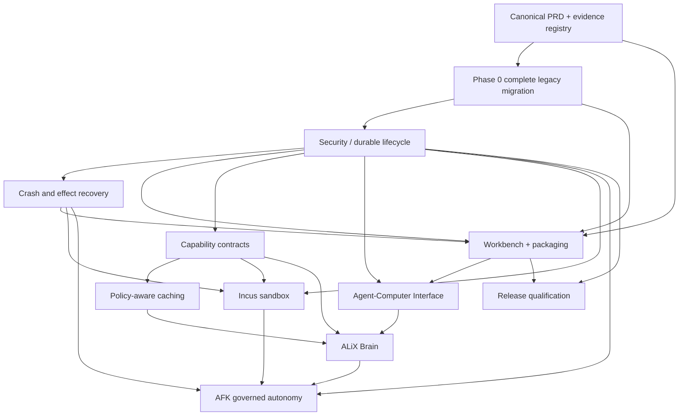

# ALiX — Master Product Requirements Document

**Document type:** Product Requirements Document (PRD)  
**Version:** 2.7 — Harness efficiency and governed software-factory amendment; Q01–Q15 preserved  
**Date:** 2026-10-19 (revision 2.7)  
**Status:** DRAFT — product-direction proposal; not a claim that all requirements are implemented  
**Product:** ALiX (local-first, governed multi-agent orchestration harness)  
**Intended canonical repository location:** `docs/product/PRD.md` (subject to repository inventory)  
**Source baseline:** ALiX PRD & Roadmap Consolidation Handoff (2026-10-15), supplied project history, user-reported Gate 5/6 and Gate 7 integration evidence through 2026-10-19, and operator decisions on complete legacy elimination and crash resilience. Evidence is reported, not independently verified from repository.

**Revision note:** Version 1.1 added mandatory pre-feature legacy migration, crash/effect recovery, operating model, threat/privacy controls, release/upgrade acceptance, and question-driven gap review. Version 1.2 records the operator’s Q02 decision: automatically retry only verified-idempotent operations; otherwise stop and ask. Version 1.3 records Q01: daemon-owned work continues on terminal disconnect under existing permissions and budgets; terminal-owned interactive work pauses safely. Version 1.4 records Q03: durably persist every critical state transition; batch only noncritical telemetry. Version 1.5 records Q04: migrate all readable supported historical data, verify integrity, archive immutable originals, and retire legacy runtime readers; explicitly resolve any unmigratable records before Phase 0 closure. Version 1.6 records Q05: intentional ALiX 2.0 breaking changes, with migration tools and documented replacements, and no legacy runtime shims. Version 1.7 records Q06: local-to-cloud or cross-provider fallback is automatic only to explicitly policy-approved providers for the task and data classification, within cost, privacy, and capability limits; otherwise queue or pause and notify. Version 1.8 records Q07: isolate and durably pause an exhausted worker, notify the operator, allow independent workers to continue only within their own and global budgets, and require renewed budget or authority to resume. Version 1.9 records Q08: AFK agents may execute only bounded, pre-authorized actions within explicit policy, scope and budgets; high-risk actions require approval, and unavailable approval causes a durable pause. Version 2.0 records Q09: category- and scope-based retention with verified active-store/index/cache deletion, documented backup expiration or controlled erasure, and only explicitly required minimal audit evidence retained. Version 2.1 records Q10: first-release certification is Linux x86-64 and ARM64, including CPU-only CLI, daemon, OpenTUI, and local-model operation; macOS, Windows, and container deployment require later independent qualification. Version 2.2 records Q11: verified success requires authoritative terminal state, durable execution evidence, and independent task-appropriate verification; unverified outcomes cannot be presented as successful. Version 2.3 records Q12: evidence-first reconciliation of unknown external effects, operator-visible evidence and options, explicit operator confirmation or separately authorized retry, and no fabricated success. Version 2.4 records Q13: explicit authorized maintainer release approval after technical qualification and clearance of applicable independent security publication restrictions, with both decisions recorded. Version 2.5 records Q14: configurable policy-based audit retention, immutable integrity-verifiable evidence, preservation under investigations or mandatory holds, and verifiable secure retirement after expiry. Version 2.6 records Q15: zero loss of acknowledged critical transitions, measured Linux x86-64/ARM64 daemon/worker/host recovery baselines, and enforceable release RTO thresholds derived from evidence.

**Version 2.7 amendment:** Adds a linked pre-2.0 harness rationalization PRD and requirements for measured model-scaffolding retirement, factory outcome metrics, declarative factory definitions, benchmark-driven routing, governed improvement and event-driven autonomy. These are proposed product requirements, not implementation claims. Q01–Q15 and existing publication/security holds remain unchanged.

> **Reset principle:** Reset the *product plan and source of requirements*, not the codebase, audit history, security controls, or evidence. No destructive Git operation is authorized by this PRD.

---

## 1. Executive summary

ALiX is a **local-first, multi-provider, multi-agent execution and coordination system** that converts an operator's goals into bounded, inspectable, recoverable work. It must coordinate specialist agents, route work to suitable models and tools, maintain useful context and durable evidence, and enforce explicit human and policy authority at every execution boundary.

ALiX is **not** merely a chatbot, a terminal UI, an autonomous coding loop, or an aggregation of AI APIs. Its differentiator is the combination of **reliable coordination, governed action, durable state, evidence-backed outcomes, and operator control** across local and cloud models.

The product reset establishes a single requirements baseline and a sequence of measurable releases. Existing features are retained when supported by evidence; historical phase labels do not determine priority. Security and lifecycle correctness precede expansion into unattended autonomy.

### 1.1 Product promise

An operator can submit a goal, inspect the plan and agents, approve or deny consequential actions, leave and resume work, and obtain artifacts and a trustworthy account of what actually happened—without granting the model more authority than the operator configured.

### 1.2 Definition of success

ALiX is successful when it can **reliably finish useful multi-step work under constrained resources**, and when a failure, denial, restart, or partial result is represented truthfully and recoverably rather than being disguised as success.

## 2. Problem and opportunity

Current agent harnesses often struggle with fragmented configuration, opaque execution, brittle multi-agent handoffs, non-durable approvals, excessive context/token consumption, weak recovery, or misleading success signals. Local-first users additionally face hardware constraints and provider availability changes. ALiX addresses these problems through a governed coordination kernel with interchangeable models and interfaces.

### 2.1 Jobs to be done

1. **Delegate:** Break a complex goal into safe, inspectable tasks for one or several agents.
2. **Control:** Authorize actions according to operator policy, ownership, and environment.
3. **Observe:** See who is working, what is blocked, what changed, and why.
4. **Recover:** Resume after interruption without replaying consumed permissions or duplicating effects.
5. **Verify:** Confirm artifacts and outcomes from durable evidence rather than agent assertions.
6. **Optimize:** Balance model quality, cost, latency, context and available local hardware.
7. **Extend:** Add models, capabilities, tools and isolated execution backends without bypassing governance.

## 3. Users, personas and supported use cases

### 3.1 Primary users

- **Individual technical operator:** Linux developer/homelab owner using CLI/TUI, local models and optional cloud fallback.
- **Developer / maintainer:** Builds software, researches issues, edits files, runs tests and reviews agent-produced changes.
- **Operations administrator:** Oversees daemon jobs, permissions, approvals, audit trails, recovery and infrastructure.
- **Advanced agent-platform developer:** Adds specialist agents, tool adapters, model providers, evaluation scenarios and policies.

### 3.2 Initial use cases (must support before broad autonomy)

| ID | Use case | Required outcome |
|---|---|---|
| UC-01 | Interactive coding task | Scoped edits, relevant tests, diff and verified artifact summary |
| UC-02 | Multi-agent parallel work | Disjoint ownership, dependencies, deterministic aggregate status |
| UC-03 | Human-approved filesystem/tool action | Durable, correctly bound approval; single-use semantics enforced |
| UC-04 | Restart interrupted coordination | Recover authoritative state; no duplicate work or approval replay |
| UC-05 | Research and synthesis | Traceable sources, bounded retrieval and explicit uncertainty |
| UC-06 | Local-model workflow | Works with configured local endpoint under resource constraints |
| UC-07 | Mixed local/cloud execution | Provider fallback within cost, privacy and permission rules |
| UC-08 | Operator Workbench | Navigate agents, approvals, tools, artifacts, failures and history |
| UC-09 | Scheduled/background job | Governed checkpoints, stop controls, notifications and recovery (future) |
| UC-10 | Isolated tool execution | Enforced resource, network and filesystem limits (future Incus backend) |

## 4. Scope, priorities and non-goals

### 4.1 Priority scheme

- **P0 / Release-blocking:** Security invariants, correct execution outcomes, durable authorization, recoverability, integrity of evidence.
- **P1 / Core product:** Multi-agent coordination, CLI/TUI usability, model/provider interoperability, artifact verification, deployment.
- **P2 / Efficiency and extensibility:** Capability registry, caching, context engineering, evaluation, plugin ecosystem.
- **P3 / Advanced autonomy:** Cognitive routing, adaptive learning, unattended AFK operation, broader domain automation.

### 4.2 Explicit non-goals

- Unbounded agent autonomy without policy, resource and human-control boundaries.
- A second authority engine, agent loop, approval store or audit ledger hidden inside a new feature.
- Guaranteeing exactly-once external side effects solely because an approval is single-use.
- Treating model confidence or self-reported completion as verification.
- Replacing proven subsystems solely to match a new framework or UI library.
- Hardcoding one model provider, one model ID, or a particular hardware accelerator.
- Retaining obsolete APIs, compatibility-only runtime paths, or historical readers indefinitely; all supported consumers and historical data must be migrated before removal.
- Granting remote approval powers before identity, authorization, evidence and durability gates pass.

## 5. Product principles and architecture constraints

1. **Local-first, cloud-optional.** Sensitive state remains under operator control; external models are explicit choices.
2. **Authority stays in code and policy.** Models propose; deterministic components authorize and execute.
3. **Fail closed.** Missing, stale, malformed or ambiguous authority never silently becomes permission.
4. **Evidence before success.** Terminal status, verified aggregate and durable outcome must agree.
5. **Durable by design.** Restarts must preserve run identity, approvals, ownership and history.
6. **One owner per contract.** Extend existing subsystem owners; avoid shadow state and duplicate policies.
7. **Bounded work.** Budgets, timeouts, retries, parallelism and context are explicit.
8. **Observable without noise.** Emit meaningful transitions; avoid unconsumed high-volume no-op events.
9. **Migration before deletion.** Migrate supported historical data and callers, verify recovery, then remove executable legacy compatibility paths; keep immutable historical evidence.
10. **Measurable improvements.** Evaluate on fixed task corpora; distinguish anecdotes from benchmarks.

### 5.1 Existing architectural reference

Project history reports a migration to **12 subsystems, four layers and zero import cycles**. This PRD adopts the *layering principle* but does not certify that exact count on the current repository HEAD. The canonical architecture inventory must be verified during baseline reconciliation.

| Layer | Responsibility | Boundary |
|---|---|---|
| Experience | CLI, TUI/Workbench, Inspector, API | Command and projection; no independent policy decisions |
| Coordination | Sessions, planning, worker graphs, scheduling, agents | Propose and orchestrate; no authorization bypass |
| Control | Governance, approvals, security, ownership, audit | Authoritative policy and evidence |
| Execution / foundations | Tools, model providers, runtime state, persistence, observability | Execute authorized actions and persist factual outcomes |

These are logical responsibilities; repository ownership names and imports must be mapped to the current architecture before implementation.

## 6. Functional requirements

Each requirement has a stable **PRD-R** identifier independent of historic P/X/A/M milestones. Status below is a *product requirement*, not proof of implementation. Verification is tracked in a separate evidence matrix.

### 6.1 Goals, sessions and orchestration

| ID | Priority | Requirement | Acceptance |
|---|---|---|---|
| PRD-R001 | P0 | Create durable run/session identity and lifecycle | Survives process restart with correct status |
| PRD-R002 | P1 | Classify intent and select direct vs coordinated execution | Deterministic routing evidence; operator override available |
| PRD-R003 | P1 | Produce inspectable task plans with dependencies and owners | Graph valid, editable/approvable under policy |
| PRD-R004 | P0 | Dispatch multiple workers with bounded concurrency | Parallel independent tasks; dependencies respected |
| PRD-R005 | P0 | Enforce path/resource ownership and prevent unsafe overlap | Exact vs recursive claims tested before mutation |
| PRD-R006 | P0 | Propagate worker failure and dependency attribution | Correct terminal aggregate; dependents not incorrectly run |
| PRD-R007 | P0 | Distinguish running, blocked, awaiting approval, idle, completed and failed; **Q11 (APPROVED):** verified success requires authoritative terminal state, durable execution evidence and independent task-appropriate verification | No nonterminal, agent-asserted or unverified success receipt; missing evidence is unverified/incomplete |
| PRD-R008 | P0 | Resume after restart or interrupted approval | No duplicate dispatch or reusable consumed claim |
| PRD-R009 | P0 | Provide explicit retry, cancellation, pause and stop semantics | Idempotent controls; durable transitions |
| PRD-R010 | P1 | Support specialist agents with bounded roles and budgets | Roster, permissions and result provenance available |

### 6.2 Governance, security and approvals

| ID | Priority | Requirement | Acceptance |
|---|---|---|---|
| PRD-R011 | P0 | Centralize policy authorization for every consequential tool action | Denial before side effect; no alternate bypass route |
| PRD-R012 | P0 | Bind approvals to run, worker, attempt, action, args, claims and policy revision as applicable | Replayed or mismatched binding rejected |
| PRD-R013 | P0 | Atomically consume single-use approvals | One authorization winner under concurrency |
| PRD-R014 | P0 | Separate approval consumption from verified execution outcome | Pending/unknown never misreported succeeded |
| PRD-R015 | P0 | Model-supplied session mode may tighten, not loosen host policy | Ask host cannot become auto/bypass via model argument |
| PRD-R016 | P0 | Preserve durable authorization/evidence across restart | Fresh process rejects stale, revoked and consumed grants |
| PRD-R017 | P1 | Support human review and denial in CLI/TUI and controlled remote interfaces | Visible binding, audit and operator identity |
| PRD-R018 | P0 | Gate remote approvals behind identity and independent acceptance | No remote authority before prerequisites pass |
| PRD-R019 | P0 | Protect secrets, workspace boundaries and network access | Negative tests and redacted evidence |
| PRD-R020 | P1 | Provide policy versioning, explainability and governance review | Every decision attributable to policy revision |

### 6.3 Tools and Agent-Computer Interface (ACI)

| ID | Priority | Requirement | Acceptance |
|---|---|---|---|
| PRD-R021 | P1 | Typed, documented tool contracts and bounded outputs | Schema validation and explicit errors |
| PRD-R022 | P1 | Ranked/scoped search and windowed file viewing | Task corpus demonstrates useful retrieval with caps |
| PRD-R023 | P0 | Safe file editing with preconditions, atomicity and diffs | Concurrent mutation detected; no unauthorized write |
| PRD-R024 | P1 | Structured tool observations and recovery hints | Errors distinguish denial, conflict, missing and retryable |
| PRD-R025 | P1 | Context projection and on-demand evidence retrieval | Compression never deletes authoritative evidence |
| PRD-R026 | P1 | Idempotent behavior for already-satisfied operations where safe | Same-content create passes; changed content follows explicit policy |
| PRD-R027 | P2 | Evaluate ACI improvements against a fixed-model baseline | Comparative solve/cost/safety metrics reported |
| PRD-R028 | P2 | Support audited extensible tools and plugins | Registration, permission, version and disable contracts |

### 6.4 Models, routing and memory

| ID | Priority | Requirement | Acceptance |
|---|---|---|---|
| PRD-R029 | P1 | One canonical model configuration source | No conflicting runtime model aliases or silent overrides |
| PRD-R030 | P1 | Support local and multiple cloud providers | Discovery, endpoint config, health and fallback tested |
| PRD-R031 | P1 | Route by task needs, capabilities, privacy, cost and context | Decision recorded; no hardcoded provider ID |
| PRD-R032 | P1 | Respect model-specific endpoints in all execution paths | Planner, workers and direct runs honor config |
| PRD-R033 | P1 | Maintain project/session/long-term memory with provenance | Retrieval scope and deletion/retention controls |
| PRD-R034 | P2 | Cache safe model/tool/context results with invalidation | Correctness parity, provenance and hit-rate metrics |
| PRD-R035 | P2 | Expose token, cost, latency and context budget projections | Reconciled usage across agents and providers |
| PRD-R036 | P3 | Cognitive planning/routing improvements (ALiX Brain) | Benchmarked improvement without new authority plane |

### 6.5 Interfaces, observability and deployment

| ID | Priority | Requirement | Acceptance |
|---|---|---|---|
| PRD-R037 | P1 | CLI and daemon for foreground and persistent operation | Documented commands, startup, shutdown and recovery |
| PRD-R081 | P0 | Separate durable daemon-owned work from terminal-owned interactive work; terminal disconnect must not cancel daemon-owned runs or silently detach interactive runs | Disconnect/reconnect E2E verifies continuation within existing authorization/budgets, safe interactive pause, state restoration and explicit operator controls |
| PRD-R038 | P1 | Multi-agent Workbench with roster, approvals, artifacts and diagnostics | Keyboard navigation, streaming stability and responsive layouts |
| PRD-R039 | P1 | Native OpenTUI renderer with feature parity | PTY E2E, focus, approval and restart tests |
| PRD-R040 | P0 | Durable events, audits and evidence with integrity validation | Reconstructable outcome and tamper detection |
| PRD-R041 | P1 | Actionable metrics and low-noise tracing | Run/worker/tool correlations and no-op suppression |
| PRD-R042 | P1 | Reproducible installation, configuration and upgrade | Supported platform smoke tests and rollback |
| PRD-R043 | P2 | Inspector/API access with principal-aware security | Authentication, authorization and audit tests |
| PRD-R044 | P2 | Sandboxed execution backend (Incus) | Isolation, resource/network limits, cleanup and restart |
| PRD-R045 | P3 | Governed unattended/AFK operation with Q08-approved bounded, pre-authorized actions; high-risk actions require explicit approval and must pause when approval is unavailable | Checkpoints, scope and budget enforcement, high-risk denial/approval tests, kill switch, notification, revocation and recovery |
| PRD-R046 | P1 | Versioned evaluation harness and release evidence | Reproducible scenarios and source-controlled verdicts |

### 6.6 Crash resilience, recovery, and side-effect integrity (mandatory P0)

| ID | Priority | Requirement | Acceptance evidence |
|---|---|---|---|
| PRD-R047 | P0 | Recover after daemon crash, process kill, host reboot and power interruption from committed authoritative state | Fault injection at every defined transition; no invented completion |
| PRD-R048 | P0 | Durably persist checkpoint and attempt identity at every critical authority, dispatch, approval, tool intent/result, worker-state and terminal transition; batch only noncritical telemetry | Restart reproduces run/worker/dependency state without phantom dispatch |
| PRD-R049 | P0 | Fence stale coordinators/workers with durable ownership, lease or epoch semantics | Competing recovery processes cannot both authorize the same dispatch |
| PRD-R050 | P0 | Journal intended external effects and reconcile unknown outcomes before retry | Unknown non-idempotent effect blocks or requires explicit operator decision |
| PRD-R051 | P0 | Guarantee at-most-once approval consumption, not universal exactly-once external effects | Crash-window and concurrent-consumer negative tests |
| PRD-R052 | P0 | Restore approval-blocked workers, pending approvals, revocations and policy revisions correctly | No duplicate request, stale approval reuse or accidental escalation |
| PRD-R053 | P0 | Preserve completed worker evidence and dependency outcomes through restart | Verified completed work not silently re-executed |
| PRD-R054 | P0 | Persist and honor cancellation, pause and shutdown intentions across restart | Cancelled runs never redispatch without explicit new authority |
| PRD-R055 | P0 | Detect torn/corrupt state, validate checksums and provide tested backup/restore | Corruption fails safely; backup restoration proven in fresh environment |
| PRD-R056 | P0 | Expose interrupted, recovering, blocked and outcome-unknown states to CLI, TUI and API | Operator can identify safe next action; no false success |
| PRD-R057 | P0 | Handle mixed allow/ask/deny capability decisions in worker approval reconciliation | Each gated capability matched to its own valid bound approval; all other required decisions validated |
| PRD-R084 | P0 | **Q15 (APPROVED):** guarantee zero loss of acknowledged critical transitions and establish evidence-derived, enforceable recovery RTO thresholds for daemon, worker and machine restart on certified Linux x86-64 and ARM64 before release | Kill-point durability corpus plus reproducible per-platform recovery benchmark report, versioned thresholds and release-gate verdicts |
| PRD-R058 | P1 | Bound retry, backoff, provider fallback and timeout policies with cost and privacy limits. **Q06 (APPROVED):** automatic fallback is permitted only to providers explicitly approved for the specific task and data classification, with enforced cost, privacy, and capability constraints; otherwise queue or pause and notify. | Retry budgets survive restart; unauthorized or over-budget fallback is denied, including after recovery; provider selection and notification are auditable |

### 6.7 Mandatory legacy elimination and canonicalization (pre-feature baseline)

| ID | Priority | Requirement | Acceptance evidence |
|---|---|---|---|
| PRD-R059 | P0 | Inventory explicit and unmarked obsolete code, dynamic consumers, deprecated packages and duplicate authorities | File/symbol/entry-point matrix on actual integrated HEAD |
| PRD-R060 | P0 | Migrate **all readable supported historical records** (sessions, approvals, audits, evidence, coordination, configuration, tasks, and other inventoried supported families) into canonical storage before retiring compatibility readers; explicitly resolve every unmigratable record before Phase 0 completion | Idempotent migration, per-family counts, identity/integrity checks, immutable original archives, restore and rollback rehearsal; no silent discard |
| PRD-R061 | P0 | Migrate all supported callers and retire obsolete runtime APIs, flags, aliases, adapters, stubs and feature switches. **Q05 (APPROVED): ALiX 2.0 intentionally breaks obsolete CLI/API/config/plugin interfaces; provide migration tooling and documented canonical replacements, with no legacy runtime shims.** | All supported internal consumers migrated; external migration tooling validated on representative prior installations; explicit unsupported-interface errors; no reachable compatibility-only production paths |
| PRD-R062 | P0 | Enforce one canonical writer, authority and event vocabulary per domain | Static architecture guards plus runtime consistency tests |
| PRD-R063 | P0 | Replace deprecated dependencies, resolve vulnerability exceptions and remove dead production code | Dependency audit and dynamic entry-point checks; zero expired unreviewed exceptions |
| PRD-R064 | P0 | Preserve immutable audit and migration evidence while removing executable legacy paths | Historical provenance retained; no old runtime fallback |
| PRD-R065 | P0 | Block new PRD feature implementation until mandatory cleanup acceptance passes | Signed Phase 0 completion matrix with no unapproved exceptions |

### 6.8 Operations, data governance and product completeness

| ID | Priority | Requirement | Acceptance evidence |
|---|---|---|---|
| PRD-R066 | P1 | Install and operate via reproducible package/service lifecycle | Clean-host install, startup, upgrade, restart, uninstall smoke tests |
| PRD-R067 | P0 | Version configuration, ledger and plugin schemas with preflight migration and recovery | Backup/restore and failed-upgrade rollback without silent data loss |
| PRD-R068 | P0 | Scope secrets and sensitive context by operator, project, provider and worker | Denial tests; redaction in logs, prompts and exported evidence |
| PRD-R083 | P0 | **Q14 (APPROVED):** Retain immutable, integrity-verifiable audit evidence under configurable per-category periods; enforce scoped investigation/mandatory holds; securely retire expired evidence with verifiable minimal receipts | Tamper detection, hold lifecycle, crash-safe expiry, post-hold retirement, segment-proof continuity, backup disposition and non-resurrection tests |
| PRD-R069 | P1 | **Q09 (APPROVED):** Enforce policy-based retention by data category and scope; support verified deletion across active stores, memory, indexes and caches, with backup expiration or controlled erasure and only explicitly required minimal audit evidence retained | Test cross-store erasure, search non-discoverability, backup expiry/restore re-deletion, legal/audit exception minimization, deletion receipts and crash-safe reconciliation |
| PRD-R070 | P1 | Enforce durable worker-level and run-level budgets for CPU, RAM, disk, tokens, network, concurrency, wall time and cost. **Q07 (APPROVED):** when a worker exhausts its limit, isolate and pause that worker, checkpoint and notify; independent workers may continue only within their own and the global run limits. Resume requires renewed budget or authority. A global run budget exhaustion pauses all further run dispatch. | Deterministic worker-only and global exhaustion tests; no overspend or unauthorized redistribution, no dispatch by exhausted workers, and safe recovery across daemon restart |
| PRD-R071 | P1 | Provide operator-visible health, diagnostics, safe mode and actionable recovery commands | Failed provider/store/worker diagnosed without guessing |
| PRD-R072 | P1 | Specify plugin and tool supply-chain trust, version compatibility and revocation | Untrusted plugin cannot inherit implicit authority |
| PRD-R073 | P1 | Support explicit provider outage and offline behavior; queue or pause and notify when no eligible policy-approved fallback exists | No unauthorized cloud fallback or leaked context; recoverable queued work and actionable operator notification |
| PRD-R074 | P1 | Define artifact provenance, verification and safe publication/export; **Q11 (APPROVED):** artifact verification must use independent, task-appropriate checks rather than agent self-report | No generated artifact published or treated verified without policy, durable evidence and independent verification |
| PRD-R075 | P1 | Support workspace concurrency, file conflict detection and external modification reconciliation | Concurrent edits fail safely; ownership conflicts tested independently of dependency serialization |
| PRD-R076 | P1 | Define multi-user/remote scope and tenant isolation before enabling those modes | No remote or multi-user authority without separate acceptance |
| PRD-R077 | P1 | Define reproducible evaluation, upgrade compatibility and regression budgets | Versioned corpora, fixed seeds where possible, measured reliability trend |
| PRD-R078 | P1 | **Q12 (APPROVED):** Reconcile unknown external effects using authoritative receipts/state and a durable effect journal; present evidence and safe operator choices for verified confirmation, separately authorized new attempt, or acknowledged unresolved disposition. Never fabricate success or reuse consumed authorization. | Crash/late-receipt tests, read-only reconciliation, duplicate-risk acknowledgment, fresh approval binding, durable unresolved status, CLI/OpenTUI parity |
| PRD-R079 | P1 | Make direct, coordinated, background and scheduled modes share policy, receipts and state semantics | Cross-entry-point parity tests; no mode-specific bypass |
| PRD-R080 | P1 | Document and test how installation and storage survive disk-full, permission errors and abrupt shutdown | Injected IO failures produce explicit recoverable outcomes |
| PRD-R082 | P0 | **Q13 (APPROVED):** Gate publication on documented technical qualification, clearance of all applicable independent security publication restrictions through their designated processes, and explicit authorized maintainer approval; persist both clearance and maintainer decisions against the exact release artifact | Negative tests reject release on missing/expired clearance, absent maintainer approval, mismatched artifact, or technical FAIL; immutable auditable decision evidence |

## 7. Trust model and authority hierarchy

**Operator/configured policy → governance authorization → coordination decision → worker execution → durable evidence → verified presentation.** A model may request an action or tighter permissions but may not grant itself permissions. UI inputs from authenticated operators have their own contract; they must not be conflated with model arguments.

### 7.1 Required invariants

- A consumed single-use approval cannot authorize another attempt.
- A terminal successful tool result requires authoritative terminal completion and supporting aggregate evidence.
- Nonterminal, blocked, unknown or unverifiable states cannot emit a succeeded execution receipt.
- Approval wait states must not be misclassified as idle solely because the worker was blocked in a prior tick.
- A worker may write only within its authorized exact/recursive ownership claims.
- Concurrent approval and dispatch races must not duplicate side effects without an explicit idempotency contract.
- Historical readers may recover legacy records, but must not supersede authoritative ledger facts.
- All remote execution and approval actions require authenticated principal and scoped policy authority.

### 7.2 Security acceptance and release policy

A passing unit test does not substitute for real UI, daemon, store and restart evidence. Security fixes require negative tests, red/green evidence where feasible, and independent review. **Gate 6 acceptance is reported PASS/CLOSED for the local qualified candidate; Gate 7 publication remains HOLD.** This PRD does not authorize publication or deployment.

## 8. Persistence, crash resilience and evidence

### 8.1 Durability and authority

The authoritative store must have explicit owners and atomic transition boundaries. Sessions, coordination runs, worker attempts, approvals, policy revisions, ownership claims, effect intents, verified artifacts and outcomes must survive process restart. **No compatibility-only reader may remain after Phase 0 migration is verified.** Historical raw records may be archived as immutable evidence, not used as runtime authority. Never infer success from a file's existence or a model's final message.

The baseline must document which transitions are atomic within one store, which require a transactional outbox/inbox or reconciliation, and which external effects cannot be made atomic with local state. No cross-system exactly-once claim is allowed without a demonstrated end-to-end protocol.

### 8.1.1 Historical-data migration contract (Q04 — approved)

- Enumerate every readable supported historical record family and all discoverable records before migration; record provenance and source schema/version.
- Back up and archive original records immutably before mutation. Migrate into canonical storage using idempotent, restartable tooling with deterministic identity mapping and duplicate detection.
- Verify per-family and per-record counts, referential links, integrity, audit chain continuity where applicable, authorization identities, and restored access through canonical readers.
- Produce a signed migration manifest identifying migrated, verified, and unmigratable records. **Every unmigratable record requires explicit operator disposition before Phase 0 can close**; do not silently drop, synthesize success, or weaken audit evidence.
- Rehearse interrupted migration, rollback and fresh-process recovery. Retire old runtime readers only after verification and archive validation; archives remain evidence, not runtime authority.

### 8.2 Recovery state machine

Every durable run/worker must distinguish at least: `pending`, `ready`, `running`, `awaiting_approval`, `blocked`, `interrupted`, `recovering`, `outcome_unknown`, `completed`, `failed`, `cancelled`. Exact implementation vocabulary may differ, but projections must preserve these meanings and never map nonterminal states to success. `outcome_unknown` is not an automatic retry signal.

Recovery sequence: acquire/fence coordinator ownership → validate authoritative storage and policy → load checkpoints and effect journal → reconcile in-flight attempts and external effects → restore approvals/dependencies/cancellation → reauthorize eligible work → dispatch safely → verify terminal evidence → expose actual state to operator. Completed verified work must not be rerun merely because a daemon restarted.

### 8.2.1 Recovery service-level objectives (Q15 — APPROVED)

- **RPO for acknowledged critical transitions: zero.** Once ALiX acknowledges a critical state transition as durably committed, it must survive supported process/daemon crashes and host restarts within the certified storage durability assumptions. Never acknowledge a transition before its durable commit. This does **not** promise zero loss of unacknowledged in-flight computation, external provider responses, or effects that cannot be atomically committed with the ledger; those follow Q02/Q12 reconciliation.
- **RTO must be measured, then made enforceable before release.** Benchmark daemon restoration, worker reconciliation and whole-machine recovery separately on certified Linux x86-64 and ARM64 environments, including representative CPU-only and constrained-memory profiles. Define start/end timestamps and distinguish restoration of safe control/visibility from completion of long-running external work.
- **No invented numeric RTO.** Collect repeated runs for normal restart, forced kill, power interruption, storage recovery and outstanding approval/effect states. Publish hardware, dataset size, load, percentile distributions, worst observed outcomes, sample sizes, failure counts and any exclusions. Set versioned numeric RTO acceptance thresholds **before release qualification**, based on that evidence; a threshold cannot be loosened post-test to make a failing candidate pass without an explicit reviewed change.
- **Release enforcement.** Both certified architectures must pass the zero-acknowledged-critical-state-loss corpus and their published recovery thresholds. Timeouts, irrecoverable corruption, lost committed state, duplicate unauthorized dispatch/effects or false success block release. External services and manual operator response times must be reported separately rather than hidden in daemon recovery statistics.
- **Observability.** Persist recovery attempts and outcomes; expose recovery duration, backlog, lease/fencing actions, recovered identities, blocked/unknown effects and measured RPO/RTO evidence to the operator.

### 8.3 Failure and interruption matrix

| Interruption point | Required safe behavior |
|---|---|
| Before durable dispatch | No worker launched; eligible work can be dispatched after recovery |
| After durable dispatch but before worker acknowledgement | Detect orphan/lease expiry and reconcile before launching another attempt |
| After approval request or while awaiting human action | Restore exact bound approval and blocked state; never duplicate authority |
| After approval consumption but before tool start | Preserve consumed grant; recovery cannot replay it; reauthorization rules explicit |
| During verified-idempotent file/tool effect | Reconcile result first; automatically retry only when operation-specific idempotency, stable identity, current authorization and preconditions are verified |
| During non-idempotent or unverified external effect | Mark outcome unknown; reconcile where possible; otherwise stop and ask before any further action |
| After effect but before durable receipt | Reconcile actual side effect; do not claim failure or repeat blindly |
| After worker completion but before aggregate commit | Reconstruct from durable worker evidence and verify aggregate |
| After cancellation or pause | Preserve intent and fence stale workers; do not redispatch |
| During schema upgrade, disk-full, corruption or restore | Stop writes safely; recover from verified backup/migration checkpoint |
| During network/model outage | Bounded backoff; preserve privacy, budget, attempts and provider constraints |
| UI/TUI disconnect while daemon runs | **Q01 APPROVED:** daemon-owned work continues under existing permissions, budgets and cancellation controls; terminal-owned interactive work checkpoints and pauses safely; reconnect restores state without duplicate dispatch |

### 8.3.1 Terminal disconnect and execution ownership (Q01 — APPROVED)

**Ownership must be explicit and durable.** Each run is classified as `daemon_owned` or `terminal_owned_interactive` before dispatch, and the classification is recorded in authoritative state. A terminal closing, SSH dropping, OpenTUI exiting, or client transport failing is **not** an instruction to cancel a daemon-owned run. Daemon-owned work continues only within the permissions, policy revision rules, budgets, concurrency limits and approval gates already applicable to it; disconnection never grants additional authority or converts pending approvals into approvals. Jobs blocked for approval remain blocked.

Terminal-owned interactive work must **pause safely** on disconnect: persist pause intent and a recoverable checkpoint, stop further dispatch, and reconcile/fence in-flight operations according to the crash/effect contract. An unstoppable external effect must be tracked to a verified or `outcome_unknown` result, never represented as safely paused before reconciliation. Reconnection must reattach to the same session/run identity, restore worker/approval/artifact views, and offer an explicit authorized resume action. No implicit conversion from terminal ownership to daemon ownership is permitted; an explicit handoff would require its own future contract and authorization.

**Acceptance:** (1) close OpenTUI during a daemon-owned multi-worker run and confirm continued bounded execution and truthful completion; (2) disconnect SSH during a terminal-owned interactive run and confirm durable pause, no new dispatch, safe in-flight handling and explicit resume; (3) reconnect multiple clients without duplicate work or elevated authority; (4) restart daemon during disconnection and preserve both ownership policies; (5) verify cancellation, budget exhaustion, denial and pending approvals still take precedence.

### 8.3.2 Durable checkpoint boundaries (Q03 — APPROVED)

**Every critical state transition must be durably committed before ALiX proceeds past the boundary it protects.** Critical boundaries include run/worker creation and attempt identity; ownership and coordinator fencing; authorization decisions, approval requests and atomic consumption; dispatch intent and acknowledgement; tool/effect intent before invocation and observed result after invocation; worker status and dependency transitions; pause, cancellation and budget enforcement; and verified terminal outcomes and aggregate receipts. An event emitted only to an in-memory stream or buffered telemetry channel is **not** a durable checkpoint.

Where state and its event/receipt are required to be consistent, commit them atomically in the authoritative store or use a durable transactional outbox and recovery reconciliation. Never acknowledge a critical transition as committed until its durability contract is satisfied. After a crash between an external effect and the corresponding receipt, apply the Q02 effect-reconciliation rule; do not blindly retry. **Only noncritical telemetry** (such as token streaming, UI refresh events and low-value sampling) may be batched, dropped under documented pressure, or written asynchronously, provided it cannot change authorization, recovery state, budget accounting, or the truth of an outcome. Long-running operations may additionally emit periodic progress snapshots, but those do not replace critical-boundary commits.

**Acceptance:** inject termination immediately before and after each critical commit; restart and verify exact run/worker/attempt, approval, effect, dependency and terminal state with no phantom dispatch, duplicated consumption, or false success. Simulate failed persistence (disk-full/write error) and verify ALiX halts the protected action instead of proceeding on volatile state. Measure critical-write latency and storage growth; performance optimizations must not weaken durability.

### 8.3.3 Resource and cost budget exhaustion (Q07 — APPROVED)

Budgets are **durable, hierarchical and enforced at dispatch and consumption boundaries**: each worker has its own applicable limits, and the coordination run has aggregate limits that no worker may exceed. Persist budget allocation, reservations, measured usage, exhaustion and renewal decisions as critical transitions under Q03. Where actual usage is reported asynchronously, reserve a conservative allowance before dispatch and reconcile it against provider/tool receipts; uncertain usage must not be treated as free capacity.

When a worker reaches or is predicted to exceed an enforceable CPU, RAM, disk, token, network, concurrency, wall-time or monetary limit, stop new work for **that worker**, persist a checkpoint and `paused_budget`-equivalent blocked state, and notify the operator with the exhausted dimension, usage, limit and safe next action. Reconcile or fence in-flight operations according to the Q02 external-effect contract; do not claim that a running non-cancellable operation has stopped. **Independent workers may continue** only if their own limits and the global run limits permit it; dependent workers remain blocked until dependencies are resolved. Exhaustion of any hard global run limit stops new dispatch across the entire run and persists a run-level budget pause.

Do not automatically transfer unused worker allocations, raise limits, switch to a more expensive provider, or restart the exhausted worker. Resumption requires an explicit, auditable budget renewal or other valid operator authority, subject to non-overridable policy caps. Recovery after daemon restart must restore exact reservations, usage, exhaustion, notifications and paused states without resetting counters or duplicate charges. For physical resource pressure, prefer bounded concurrency reduction and safe cancellation/checkpoint behavior; an OS-level kill may require post-restart reconciliation.

**Acceptance:** (1) one of several independent workers exhausts its budget and only that worker pauses; (2) dependent work does not dispatch prematurely; (3) other independent workers continue within their own and global limits; (4) global budget exhaustion pauses all new dispatch; (5) a daemon restart does not reset budgets or resume paused work; (6) renewal is authorized, recorded and bounded; (7) pending/unknown in-flight effects and delayed usage receipts do not permit duplicate work or overspend; (8) operator notification and CLI/OpenTUI status distinguish worker and run exhaustion.

### 8.3.4 Unattended AFK authority (Q08 — APPROVED)

An AFK agent may plan, coordinate workers and execute tools **without a live operator only when each action is already permitted** by explicit, current policy, scoped capability grants, workspace/data boundaries, ownership claims, and durable worker/run budgets. AFK status is not an authorization mode and must never relax normal tool, approval, sandbox, model-provider, or data-classification controls. The daemon owns unattended execution; closing a terminal does not convert terminal-owned interactive work into AFK work (Q01).

**High-risk or otherwise approval-required actions must await a valid, specifically bound approval.** The agent may prepare a proposal and notify the operator, but must durably checkpoint and pause the affected worker when approval is unavailable; it must not self-approve, broaden its scope, substitute a different tool/provider to evade a gate, or use expired, stale, unrelated or consumed approvals. Independent authorized workers may continue within their own and the global run limits (Q07). Denials remain denials, even if a broader AFK task was initially authorized.

Require a durable stop/revoke control, bounded scheduling and iteration limits, visible pending approvals and notifications, and restart reconciliation. On restart, revalidate policy revision, grants, expiry, budgets, ownership and external-effect outcomes before resuming. Follow Q02 for uncertain tool effects and Q03 for critical persistence; do not retry unverified non-idempotent actions. No implicit authority renewal or budget replenishment after crash, timeout or disconnect.

**Acceptance:** (1) authorized low-risk work continues unattended within scope; (2) high-risk action without approval checkpoints and pauses without side effect; (3) correct single-use approval permits only its bound action; (4) denial, expired grant, revocation, scope escape and budget exhaustion block execution; (5) independent workers may continue only within existing limits; (6) crash/restart preserves pending approval and paused state, with no replay or privilege escalation; (7) stop switch fences new dispatch and reconciles in-flight work; (8) CLI/OpenTUI surfaces unattended state, reason for pause and operator actions.

### 8.4 External effects and retry contract

Record stable operation IDs, arguments hash, tool/provider identity, worker attempt, authorization binding, intent and observed result. Prefer idempotency keys and read-after-write reconciliation when supported. Distinguish **at-most-once authorization**, **at-least-once delivery**, and **effectively-once verified outcome**; these are not interchangeable. Operator decision Q02 (APPROVED): **automatically retry only verified-idempotent operations; otherwise stop and ask**. Before an automatic retry, ALiX must verify an applicable idempotency guarantee for the *specific operation and target*, including stable operation identity/key, compatible arguments and preconditions, valid current authorization, bounded retry budget, and no evidence of a conflicting completed effect. Merely naming a tool “idempotent,” assuming that a timeout means failure, or having a read-only-looking tool name is insufficient. If the effect can be reconciled as already completed, record the verified result rather than repeat it. If idempotency cannot be verified, the effect remains `outcome_unknown`; stop automatic dispatch and request an explicit operator decision. Operator approval cannot bypass policy denial or resurrect consumed single-use authorization. Record the evidence and rationale for every automatic retry.

### 8.4.1 Unknown external effect resolution (Q12 — APPROVED)

For any external action whose effect cannot be established after a timeout, disconnect, crash, or restart, ALiX MUST persist `outcome_unknown` with its operation identity, authorization binding, worker/run/attempt, intended effect, and available receipts. It MUST first attempt **read-only, policy-authorized reconciliation** against authoritative external state, provider receipts, and the durable effect journal. Absence of a receipt is not evidence that the action failed; model assertions and unverified tool messages are not authoritative evidence.

The operator must receive a concise evidence packet identifying what was attempted, what is known, what remains uncertain, potential duplicate effects, and the available actions:

1. **Confirm verified success:** only after sufficient authoritative external evidence and task-appropriate independent verification exist; an operator assertion alone may acknowledge an outcome but MUST NOT turn unverified evidence into a verified-success receipt (Q11).
2. **Authorize a new attempt:** only through a distinct, explicit, policy-checked authorization with correct operation identity, scope, budget, binding, and fresh single-use approval where required. A previously consumed approval MUST NOT be reused. Preserve the original attempt and unknown outcome in the journal. If the original effect may have occurred, surface duplication risk and require explicit acknowledgment; never silently replay the old attempt.
3. **Acknowledge unresolved / stop:** persist the operator's disposition, keep the original effect classified as unresolved, and prevent verified-success reporting for any task dependent on that effect.

Reconciliation may establish that an effect definitely succeeded or definitely failed, but may not infer either from a timeout. All decisions and receipts are durable and auditable. Operator resolution cannot override a policy denial, erase prior evidence, or bypass Q02's rule limiting *automatic* retries to verified-idempotent operations. If external evidence is insufficient, the effect remains unknown until resolved.

**Acceptance:** crash after external dispatch but before receipt; delayed provider success receipt; duplicate-risk warning for non-idempotent action; stale/wrong-run approval rejected; explicitly authorized new attempt uses a new identity; acknowledged-unknown outcome does not become success; recovery and OpenTUI/CLI show the same durable evidence and disposition.

### 8.5 Concurrency, recovery and backup

Use durable ownership/epoch fencing to prevent two daemon instances or resurrected workers from concurrently mutating the same run. Retain atomic approval consumption, per-capability exact binding, and policy revision validation. Provide documented consistent backup, restoration into a clean host, schema migration dry-run, rollback compatibility limits and corruption detection. Backup existence alone does not establish recoverability.

### 8.6 Qualification and operator visibility

Run deterministic kill-point tests around every critical transition, including power-loss simulation, duplicate daemon startup, stale worker, approval consumption, partial file write, mixed-capability approval, provider timeout, and disk-full. Repeat representative real daemon/real model workflows and report sample size, HEAD, environment and outcomes. CLI/OpenTUI must display what is safe to retry, what remains unknown, and what needs operator approval. **A process restart alone is not sufficient recovery evidence.**

### 8.7 Verified task completion contract (Q11 — APPROVED)

ALiX MUST distinguish **execution terminated**, **agent reported done**, **artifact exists**, and **task verified successful**. Only the last may produce a verified-success receipt. The following are jointly necessary:

1. **Authoritative terminal state:** the canonical run/worker lifecycle is terminal and its dependency/coordination aggregate is consistent with completion. An idle, approval-blocked, timed-out, interrupted or partially failed run is not successful.
2. **Durable execution evidence:** relevant actions, approvals, effects, outcomes and artifacts are durably attributable to the correct run, worker and attempt. Missing, inconsistent or corrupt evidence prevents a success claim.
3. **Independent task-appropriate verification:** a verifier other than the producing agent's self-assertion checks the requested result against explicit acceptance criteria (for example file contents and hashes, tests, repository diff, API receipt, or observed external state). Verification must not rely solely on generated narrative.

The verifier may be deterministic code or an independently scoped verifier using authoritative observations. It must declare what was checked, which evidence was used, and what could not be checked. Passing tests alone does not prove requirements those tests do not cover. Verification that needs an unavailable external authority must yield **unverified** or **outcome_unknown**, not a fabricated pass.

**Outcome contract:** `verified_success` requires all three conditions; `unverified` means work was reported or produced but verification is missing or insufficient; `incomplete` means required work or dependencies remain; `failed` means a known failure; `outcome_unknown` means an external effect cannot be established. These are conceptual outcome categories, not a mandate to rename existing persisted enum values without migration. Operator interfaces, exports, audit records and API receipts must preserve the distinction.

**Acceptance:** inject false agent-completion reports, missing artifacts, incorrect file contents, failed tests, incomplete dependency graphs, stale approval records, missing durable events and unverifiable external effects. Every case must reject verified success. Verify successful direct, coordinated, resumed and AFK runs with the same contract.

## 9. Interfaces and user experience

### 9.1 CLI

Provide discoverable commands for chat/run, agents, models, tools, approvals, sessions, daemon, configuration, audit, diagnostics and updates. Long-running operations must have explicit status, resume and cancellation behavior.

### 9.2 Workbench / OpenTUI

The Workbench must present a coordinated view of session phase, selected run, worker roster, dependencies, tools, approval cards, artifacts, diagnostics and token/usage metrics. Keyboard controls must never leak into text input. Selection persists during streaming. Narrow terminals degrade gracefully. Approval actions must act on the visible durable approval and display resulting state.

### 9.3 Inspector and API

Provide read-only and operator-action surfaces through authenticated, principal-aware interfaces. The UI must not become a second policy engine. Remote approval capability is gated separately.

## 10. Model, memory and efficiency strategy

**Model tiers** may include default, thinking, coding, fast, critic, tiny and image, but these are configuration roles rather than provider-specific IDs. Provider discovery and per-model endpoint settings must flow consistently to planner, coordinator and workers. Local execution is preferred where quality/privacy constraints permit. **Q06 (APPROVED):** if local inference fails, automatic fallback is allowed only to an explicitly policy-approved provider for the current task and data classification, within cost, privacy, and capability limits. Approval to configure a provider is not blanket authorization to transmit task data. Evaluate the destination and data classification before sending context, persist the provider-routing decision, and preserve the same constraints across retry/restart. If no eligible provider exists, queue or pause the task and notify the operator; do not silently downgrade privacy or capability requirements.

Memory is tiered into transient working context, durable session/project memory and selectively promoted long-term knowledge. Each memory item should have source, timestamp, scope and retention semantics. Caches must be policy-scoped and invalidated by relevant model, prompt, tool, file, permission or version changes.

**Q09 (APPROVED):** Apply the retention and verified-deletion contract in §10.1 to every memory tier, derived embedding, cached context and model trace; a source deletion must invalidate all dependent searchable material.

### 10.1 Data retention, verified deletion and backup lifecycle (Q09 — APPROVED)

ALiX must maintain an **operator-configurable, versioned retention policy by data category and scope**, including sessions/messages, project and long-term memory, embeddings/vector indexes, tool inputs/outputs, artifacts, coordination and effect records, model prompts/responses/traces, caches, logs, approvals, audit evidence, exports, and backups. Policy must define purpose, retention duration or event trigger, authorized principals, disposition, and narrowly scoped exceptions. Defaults must be documented; no invented universal retention period is implied by this PRD. A category cannot silently inherit indefinite retention. Retention changes are authorized and audited, and a policy cannot override mandatory preservation of a pending execution/approval/effect required for safe recovery without a safe archival or closure procedure.

A deletion request must resolve the requested scope and data lineage, then **durably record a deletion job** and remove the covered content from canonical active stores, session/project/long-term memory, embeddings, search indexes, derived summaries, and caches. Invalidate or rebuild references and projections so the deleted content is not searchable, retrievable or resurrected by replay, restart, synchronization, model-context compilation or cache warmup. Exported or externally transmitted copies are identified and handled according to their independently stated control and deletion limits; ALiX must not falsely claim erasure from third-party providers it cannot control.

**Backups and immutable archives** require a published expiration schedule or controlled erasure mechanism, with encryption-key destruction where appropriate and verifiable. Until an older backup expires or is erased, ALiX must retain a durable deletion manifest/tombstone (containing the minimum necessary non-sensitive identifiers) and **reapply deletion before restored data becomes queryable or usable**. A backup restore, historical-data migration (Q04), or recovery must not resurrect content subject to a valid deletion request. Deletion receipts distinguish active-store completion from backup expiration and external-system status; no blanket immediate-physical-erasure claim is permitted.

**Audit exception:** Retain only the minimal audit evidence explicitly required by a defined legal, security or operational retention policy, with documented reason, duration, access restriction and redaction/minimization. Do not retain full deleted payloads merely for convenience. Where deletion conflicts with a legally required hold or integrity obligation, surface the restricted exception and exact status to the operator rather than silently failing or claiming full deletion. Preserve chain verifiability using minimal non-content proofs where feasible.

### 10.1.1 Audit evidence lifecycle (Q14 — APPROVED)

**Q14 decision:** Retain audit evidence according to an operator-configurable, versioned policy with explicit periods by event class, sensitivity, scope, and applicable obligation; **do not default to indefinite retention**. While within retention, audit records must be immutable to ordinary operators and workers, access-controlled, and integrity-verifiable (for example, using append-only records and verifiable chain or segment commitments). Integrity verification must distinguish verified evidence from unverifiable historical material.

**Investigations and holds:** An active security investigation or applicable mandatory preservation hold suspends normal retirement for the specifically scoped evidence. Each hold must identify authorized issuer, justification, scope, creation time, review/expiry conditions, and release authority; changes are themselves auditable. Holds do not silently expand to unrelated content or permit use of historical evidence as live execution authority. Release of a hold resumes the normal policy disposition, subject to any other active hold.

**Secure retirement:** Once retention expires and no valid hold remains, retire covered records and sensitive payloads through a documented deletion or cryptographic-erasure procedure, including derived indexes, exports under ALiX control, and backup lifecycle as specified in §10.1. Record a minimal, non-sensitive, integrity-verifiable retirement receipt (scope, policy revision, authorized disposition, completion status, and verification evidence) without retaining the deleted payload. Where deletion of an old audit segment would break a verification chain, preserve only the minimum non-content commitment or segment-boundary proof needed to verify retained records; do not falsely assert that deleted events remain independently reconstructable. Uncontrolled external copies must be disclosed as limitations.

**Acceptance:** Verify append-only enforcement and tamper detection; configurable expiry; hold creation, authorization, scope, release and restart persistence; expiry blocked during an active hold; retirement after the final hold releases; secure deletion from searchable projections; retained-segment integrity after retirement; accurate staged backup-erasure status; and operator-visible evidence when deletion or retention fails. Test crash interruption during retention processing and prohibit successful retirement receipts until verified.

**Crash safety and security:** Deletion workflows must be idempotent and resumable, with durable state transitions, bounded retry, error escalation, and authorization checks. Deny retrieval of in-scope data while a deletion job is pending wherever technically feasible; otherwise clearly disclose the pending exposure and block successful deletion receipts. Do not let AFK workers, plugins, or restored processes override the deletion policy. Apply least-privilege access to deletion commands and avoid logging sensitive deleted content.

**Acceptance:** (1) seed representative sensitive data across all named categories and derived stores, delete by scope, and verify no unauthorized retrieval/search; (2) interrupt deletion and restart to verify completion without resurrection; (3) restore a pre-deletion backup and verify tombstones are applied before serving queries; (4) prove backup expiry/controlled erasure and accurately staged deletion receipts; (5) verify minimal audit retention and documented hold exceptions; (6) validate retention expiry, export, policy updates, and cross-scope isolation; (7) ensure legacy migration cannot reintroduce deleted records.

## 11. Nonfunctional requirements and target service levels

The following are **proposed release targets**, not measured ALiX performance:

| ID | Attribute | Proposed target / verification |
|---|---|---|
| NFR-01 | Security | Zero known release-blocking authorization bypasses in supported paths |
| NFR-02 | Integrity | 100% of success receipts backed by verified terminal evidence in qualification corpus |
| NFR-03 | Restart | 100% of prescribed recovery scenarios preserve run/approval identity |
| NFR-04 | Parallelism | Demonstrate 3 independent workers with correct bounded concurrency and ownership |
| NFR-05 | Failure | 5/5 deterministic failure-propagation qualification runs; expand sample for release |
| NFR-06 | Resource footprint | Operate in constrained CPU-only profile; publish measured memory/latency envelope |
| NFR-07 | Observability | Every action traceable by session/run/worker/attempt; no unconsumed no-op event flood |
| NFR-08 | Usability | All approval and worker states accessible via keyboard in supported terminal sizes |
| NFR-09 | Migration | 100% of identified supported historical data formats migrated and verified before retiring runtime readers |
| NFR-10 | Reliability | No silent duplicate dispatch or authorization replay in concurrency/restart corpus |
| NFR-11 | Portability | **Q10 (APPROVED):** certify Linux x86-64 and ARM64 for CLI, daemon, OpenTUI and CPU-only local-model operation; macOS, Windows and container deployment require later separate qualification |
| NFR-12 | Benchmarking | Fixed model, task, permissions and budget for comparative feature evaluations |

| NFR-13 | Crash recovery | All defined kill-point scenarios terminate in verified completed, safely blocked, failed, cancelled or outcome-unknown states; zero false success |
| NFR-14 | Recovery concurrency | Zero duplicate authorized effects in deterministic multi-daemon/lease-fencing corpus; external effects governed by reconciliation policy |
| NFR-15 | Clean baseline | Zero known reachable compatibility-only production paths, deprecated production APIs, and dead modules after Phase 0 |
| NFR-16 | Data migration | 100% of enumerated supported historical record families have verified migration or explicitly approved data-retirement disposition |
| NFR-17 | Operational recovery | Clean-host backup restoration and interrupted upgrade/rollback rehearsals pass |
| NFR-18 | Recovery RPO/RTO (Q15) | Zero loss of acknowledged critical transitions under certified durability assumptions; evidence-derived numeric daemon, worker and host RTO thresholds published and passed on both certified Linux architectures before release |

Release thresholds beyond those listed require baseline measurement before numerical commitments. These are **qualification corpus targets**, not a promise that arbitrary third-party effects are exactly once or that no undiscovered dead code exists.

## 12. Supported environments and deployment modes

### 12.1 Certified platform scope — Q10 (APPROVED)

**First ALiX 2.0 release:** Linux **x86-64 and ARM64** only. Both architectures must qualify CLI, persistent daemon/service lifecycle, OpenTUI (including terminal disconnect/reconnect), and **CPU-only local-model inference**. Local inference must be tested with documented compatible runtimes and at least one practical model profile on each architecture; model availability, RAM/CPU footprint, latency, and supported instruction sets must be measured rather than assumed. The platform certification matrix must include clean install, upgrade/migration, restart/crash recovery, approvals, backup/restore, permissions, and constrained-resource behavior. Distinguish architecture support from performance guarantees.

**Deferred certification:** macOS, Windows, and containerized deployment (including Docker/Incus packaging) each require their own explicit qualification milestones before being advertised as supported. Development experiments on those platforms are not release certification. A Linux host running ALiX directly is in scope; a containerized deployment is not automatically certified merely because its host is Linux.

### 12.2 Target modes

- **Developer local:** CLI + daemon + local storage + local/cloud models.
- **Homelab service:** persistent Linux daemon with isolated worker workspaces and optional remote access.
- **Constrained CPU-only:** low-memory local model or remote inference, reduced concurrency.
- **Isolated execution:** Incus-backed worker sandbox, future qualification target.
- **Managed multi-user:** future possibility; not a current release promise.

### 12.3 Packaging requirements

Document install, upgrade, config migration, secrets, service management, log/evidence paths, backup, restore, diagnostics and uninstall. Keep runtime dependencies and provider adapters replaceable. Never rely on a developer's untracked symlink or real HOME as part of acceptance.

## 13. Product capability inventory and evidence status

This section distinguishes **reported evidence** from **unverified present-day repository status**. A repository audit must populate the authoritative feature registry before the PRD is marked approved.

| Capability | Current evidence from project history | Status for product baseline |
|---|---|---|
| Layered architecture | 12 subsystems / four layers / zero cycles reported after migration | Reported; re-audit current HEAD |
| Multi-agent scheduler | 3-worker fan-out, dependency, failure propagation qualified in Gate 6 | Verified in reported local candidate |
| Durable approvals | Native OpenTUI approval and consumption Gate 5; F1/F3/F5 Gate 6 | Verified in reported local candidate; unpublished |
| Restart recovery | Fresh-process qualification reported PASS | Verified in reported local candidate |
| OpenTUI Workbench | PTY approval + navigation tests reported | Verified in reported test scope; parity audit pending |
| Multi-provider models | Multiple provider infrastructure and canonical model settings reported | Implemented historically; current parity audit pending |
| Agent-Computer Interface | Proposed requirements and benchmark hypothesis | Proposed |
| Capability models | Existing adapters/registry, consolidation ambitions | Mixed existing/proposed; inventory required |
| Caching | Roadmap feature | Proposed; baseline audit required |
| Incus sandbox | Architecture concept | Proposed |
| ALiX Brain | Cognitive decision/routing concept | Proposed |
| AFK agent | Unattended autonomy concept | Proposed; blocked on foundations |
| Secure remote approvals | SRAP historical program and local security remediation | Separate gate/evidence reconciliation required |
| Release packaging | Prior migration packaging work reported | Current deployment qualification required |

**Important:** A qualified local commit is not equivalent to merged `origin/main`, shipped binary, or production deployment.

## 14. Roadmap: dependency-driven product reset

Roadmap order expresses dependencies, **not** historical milestone identity. New initiative IDs are illustrative and must be collision-checked against repository docs, tags, issues, PRs and branches before allocation.

**Q05 release compatibility policy:** ALiX 2.0 is a deliberate breaking release. Ship standalone/offline migration utilities and a versioned breaking-change guide before removing obsolete CLI flags, API contracts, configuration aliases and plugin interfaces. Validate migration on representative existing configurations and integrations. The runtime must not silently translate old interfaces; unsupported usage receives an actionable error identifying the replacement. Preserve immutable migration evidence and safe rollback/export procedures.

**v2.7 integration:** Stage 0 additionally includes the read-only harness rationalization inventory, invariant register, benchmark specification and evidence-based model-scaffolding disposition defined by `ALiX_PRE_2_0_HARNESS_PRD.md`. Experimental ablations may be isolated; no production behavioral removal precedes evidence, migration, and separate authorization. Software-factory feature delivery remains post-Stage 0.

### Stage 0 — Canonical baseline, Gate 7 qualification and complete legacy elimination (mandatory)

**Stage 0A (read-only):** canonical PRD; current-head architecture and legacy/dead-code inventory, dynamic entry-point map, historical data format inventory, supported consumers, evidence registry, risk and breaking-change register.  
**Stage 0B (security):** Gate 7 local qualification **complete 2026-10-20** including F6/F7/F8a/F8b; record the two disclosed coverage gaps; preserve publication HOLD pending designated clearance.  
**Stage 0C (migration):** implement and verify idempotent historical-data migrations; consolidate canonical config, capability, policy, events, execution and UI paths; migrate callers; retire obsolete readers, wrappers, aliases, feature switches, deprecated dependencies and dead code.  
**Stage 0D (qualification):** crash/approval/concurrency fault injection, fresh-host restore, full suites, negative architecture guards, independent review.  
**Exit:** PRD-R059–R065 and all relevant P0 safety/migration requirements satisfied; no unapproved executable legacy paths; preserved audit history and recoverable data. **No new PRD feature implementation before exit.**

### Stage 1 — Stabilize core release candidate (P0)

**Deliverables:** after Stage 0, independently qualify the canonical clean implementation against current main; close release-blocking defects; qualify approvals, scheduler, crash/restart, aggregate receipts, failure propagation and Workbench.  
**Exit:** Security and crash-recovery regression suites green, independent evidence review; authorized release decision remains a separate gate.  
**Constraint — Q13 (APPROVED):** Technical PASS does not authorize publication. The authorized repository maintainer must explicitly approve the release *after* applicable independent security publication restrictions have been cleared through their designated processes. Record the technical qualification verdict, restriction clearance evidence, maintainer decision, identity, scope, timestamp, and exact release artifact/commit. A maintainer decision cannot override an uncleared independent restriction. Existing Gate 7 publication HOLD remains binding until that process explicitly clears it.

### Stage 2 — Product foundation and usability (P1)

**Deliverables:** canonical model/provider endpoint parity, deployment packaging, operator documentation, reliable OpenTUI Workbench, CLI ergonomics, robust session persistence, evaluation harness.  
**Exit:** Reproducible install/upgrade/restart, end-to-end user journeys and support matrix.

### Stage 3 — Low-dependency capability improvements (P1/P2)

**Parallel workstreams:**
- **Capability models:** typed contracts, discovery, ownership and authorization mapping.
- **Caching:** safe scoped caches, invalidation, cost measurement.
- **ACI:** inventory, fixed-model baseline, navigation/edit/observation improvements.

**Exit:** Independent A/B evaluations; no security or correctness regressions.

### Stage 4 — Controlled execution (P1/P2)

**Deliverables:** Incus sandbox worker lifecycle, workspace mounts, resource/network controls, recovery and cleanup.  
**Dependencies:** stable capability/ownership contracts, authorization, durable worker state and packaging.  
**Exit:** Isolation escape/denial negatives, resource exhaustion and restart qualification.

### Stage 5 — Cognitive intelligence (P2/P3)

**Deliverables:** ALiX Brain for planning/routing quality, confidence/evaluation loops and adaptive decisions.  
**Dependencies:** stable task corpus, capability discovery, telemetry and outcome verification.  
**Exit:** Measured gains over fixed baselines; bounded decisions; no new execution authority.

### Stage 6 — Governed unattended agents (P3)

**Deliverables:** AFK scheduling, bounded pre-authorized execution (Q08), high-risk approval/deferral, durable pause when approval is unavailable, checkpointing, notification, budgets, revocation/kill switch, isolation and recovery.  
**Dependencies:** stages 1–5 controls relevant to unattended actions.  
**Exit:** Demonstrate unattended low-risk execution only within pre-authorized scope, high-risk approval gating, durable pause on missing approval, revocation, recovery and auditable effects without human-presence assumptions.

### Stage 7 — Release and lifecycle management

**Deliverables:** reproducible release candidate, migration/rollback, threat model, docs, support matrix, known limitations and change log.  
**Exit — Q13 (APPROVED):** Independent technical/security qualification, documented clearance of any applicable independent publication restriction through its designated process, and an explicit authorized maintainer release decision; record both clearance and maintainer approval, tied to exact commit/artifact. No automatic publication solely from passing tests.

## 15. Dependency graph

This diagram is a **recommended sequencing model**, not proof that every arrow is a hard code dependency. Some Stage 3 workstreams may proceed independently after contracts are established.

## 16. Detailed ACI initiative

**Hypothesis:** Holding model, task, permissions and budget fixed, better agent-computer interfaces improve task success and/or reduce cost without compromising governance.

- **ACI-00 Inventory:** Map existing tool, search, view, edit, observation and context interfaces; identify duplicate semantics.
- **ACI-01 Baseline:** Version representative task corpus and collect solve rate, steps, tokens, time, edit failures and policy denials.
- **ACI-02 Navigation:** Ranked/scoped search, bounded results, line-numbered views and refinement guidance.
- **ACI-03 Editing:** Version-preconditioned targeted edits, validation before commit, immediate diffs and recoverable errors.
- **ACI-04 Observations/context:** Structured errors, concise current observations, on-demand historical retrieval without evidence loss.
- **ACI-05 Comparative evaluation:** Paired A/B, confidence intervals where appropriate, safety non-regression and cost reporting.
- **ACI-06 Generalization:** Apply successful patterns to non-coding domains through separate contracts and benchmarks.

**Constraint:** ACI is a logical interface across existing agent actions, observations and context presentation—not a new execution authority, loop or ledger.

## 17. Feature delivery template

Every feature PRD or implementation plan must specify:

1. Problem, target user, measurable outcome and explicit non-goals.
2. Current baseline and supporting evidence references.
3. Owning subsystem and affected trust boundaries.
4. Functional requirements and negative cases.
5. State/persistence, migration and concurrency contracts.
6. UX/API/tool contracts and compatibility requirements.
7. Dependencies and collision-checked milestone ID.
8. Acceptance tests, benchmarks and evidence artifacts.
9. Security, privacy, resource and operational risks.
10. Rollback/disable strategy and release gate.

No implementation plan may claim a feature is complete solely because code merged or unit tests passed.

## 18. Acceptance framework

### 18.1 Gate definitions

| Gate | Meaning | Required evidence |
|---|---|---|
| G-PROD-0 | Clean baseline | PRD/roadmap reconciliation, full legacy migration, historical data verification, no dead/compatibility runtime paths |
| G-PROD-1 | Contract | Reviewed requirements, non-goals, compatibility and authority boundaries |
| G-PROD-2 | Implementation | Focused unit/integration tests, build and static checks |
| G-PROD-3 | Security | Denial, replay, concurrency, ownership, restart and audit negatives |
| G-PROD-4 | Operational E2E | Real daemon/UI/provider, restart/fault injection, effect reconciliation, durable artifacts and restore evidence |
| G-PROD-5 | Effectiveness | Fixed-baseline benchmark with clear result interpretation |
| G-PROD-6 | Release | Independent review, docs, migrations, rollback, authorization |

These are **new proposed product gates**, not replacements for historic SRAP/Gate 5/Gate 6 identifiers.

### 18.2 Product release acceptance

A release candidate must demonstrate all mandatory Phase 0 migration and crash-recovery acceptance, then the following end-to-end paths: single-agent task, three-worker parallel task, dependency task, approval denial and approval consumption, interrupted run/restart, failing worker with attributed dependent, ownership enforcement, Workbench approval navigation, local-model operation, and explicit incomplete result on timeout/idle. Failures must be reported accurately, not masked by harness behavior.

## 19. Metrics and evaluation

| Dimension | Metric | Collection |
|---|---|---|
| Correctness | Verified task completion rate | Independent artifact/outcome checks |
| Safety | Unauthorized action attempts and accepted bypasses | Policy decisions and negative tests |
| Coordination | Dispatch success, dependency adherence, aggregate accuracy | Durable run/worker events |
| Recovery | Restart/resume completion and duplicate rate | Fault-injection corpus |
| Cost | Tokens, provider cost, cache savings | Provider usage reconciliation |
| Efficiency | Steps, elapsed time, idle ticks, retry overhead | Trace and scheduler metrics |
| UX | Time to locate blocked worker/approve/recover | Scripted operator journeys |
| Reliability | Intermittent scenario failure rate | Repeated deterministic and real-model runs |
| Portability | Install/upgrade success by platform | CI and release smoke tests |

Never interpret absence of an event as proof of successful execution. Report test sample sizes, exact commit, environment, provider and harness version with benchmark results.

## 20. Risks and mitigations

| Risk | Mitigation |
|---|---|
| Authorization bypass via alternate route | Single policy owner, deny tests across CLI/TUI/API/daemon |
| False completion or false receipt | Authoritative terminal and aggregate verification |
| Lost approval-to-dispatch convergence | Reconciled blocked-state accounting and restart tests |
| Duplicate worker side effects | Atomic authorization, attempt identity and explicit idempotency |
| Incomplete legacy removal or data loss | Exhaustive inventory, idempotent migrations, consumer migration, negative reintroduction guards, backup/restore evidence |
| Power loss or ambiguous external effect | Durable checkpoints, fencing, effect journal, safe unknown-outcome handling and kill-point tests |
| Double recovery or stale worker | Coordinator epochs/leases, attempt identity and atomic dispatch/approval transitions |
| Provider/model churn | Discovery, canonical config and endpoint parity tests |
| Excessive context/token usage | Bounded ACI, cache correctness and fixed-baseline measurement |
| Unbounded AFK behavior | Budgets, checkpoints, isolation, kill switch and approval gates |
| Unversioned test evidence | Local source-controlled harness, immutable verdict metadata |
| Publishing unreviewed security work | Gate 7 HOLD until authorized review and release approval |

## 21. Open decisions and validation backlog

These items are deliberately **not** silently resolved by this PRD:

1. **Current canonical source inventory:** audit live PRDs, roadmaps, docs/superseded, milestone IDs, tags and architecture owners.
2. **Mainline integration:** Gate 7 release branch `release/gate7-main-e948e356` is fast-forwarded onto local `main` at **`4ac6df14`** (tree `8bf5ac2b6dfaeccaa69567410e32e6f7a768a305`), base `e948e356`, clean replay (8 commits, 2 deduplicated). F6/F7/F8a/F8b plus build, scheduler, OpenTUI, Workbench and real-model E2E are qualified locally. Verify current HEAD before any release step; do not assume publication.
3. **Publication authorization (Q13 decided):** Gate 7 remains HOLD. Obtain documented clearance of applicable independent security publication restrictions through their designated process, then explicit authorized maintainer approval. Record both against the exact qualified artifact; do not assume that PRD approval lifts the hold.
4. **F2 shell-redirect attribution:** open, non-blocking and not reproduced in subsequent qualifying path.
5. **F4 worker approval outcome pending:** accepted fail-closed behavior; define eventual receipt contract separately.
6. **Transient clamp-reload test:** monitor for recurrence and root-cause if repeated.
7. **Ownership hard-conflict negative:** prior scenario proved dependency serialization, not unsynchronized hard-conflict rejection.
8. **Provider endpoint propagation:** verify planner/worker per-model endpoint handling without harness environment workaround.
9. **Legacy/dependency elimination:** Phase 0 must migrate historical data and all supported callers, resolve expired exceptions and transformer migration, then remove old readers, adapters, deprecated paths and dead code. No indefinite compatibility carve-out.
10. **Supported platforms and minimum resources:** benchmark actual CPU/RAM footprints before publishing a support promise.
11. **ACI benchmark corpus:** define task families, scoring, budgets, sample sizes and acceptance thresholds.
12. **Feature registry status:** reconcile each PRD-R requirement with current mainline code and tests.
13. **F6/F7/F8 approval integration:** **RESOLVED and qualified locally 2026-10-20.** F6 mixed-capability reconciliation (`46ad374a`), F7 operator-denial propagation (`0260bc36`), F8a in-process wiring (`ff9671b6`), F8b cross-process `WorkerApprovalPort` (`4ac6df14`). Real-model production-default run passed with the missing-store warning eliminated (26 → 0). Two disclosed coverage gaps remain and are **not** to be represented as covered: no explicit wrong-workspace test, and tool-level operator denial not exercised through the full TUI scenario. Publication remains HOLD.
14. **Recovery verification:** Q01–Q03, Q09, Q14 and Q15 are decided. Numeric RTO thresholds remain **implementation-time evidence deliverables**, not open product-owner policy decisions; benchmark and publish thresholds before release (§8.2.1, NFR-18).
15. **Migration support policy:** define which existing installations/data are in scope, explicit export-only dispositions if necessary, and release major-version breaking-change policy.
16. **Product completeness questions:** all Q01–Q15 policy choices are approved; resolve the evidence and specification gaps in §28 before design freeze or release. Approval of a product policy does not demonstrate implementation.

## 22. Governance of this PRD

- This document is the **proposed product requirements source of truth** once accepted and installed at the canonical path.
- Architecture documents define *how* requirements are implemented; feature PRDs refine requirements; test/evidence records establish verification; historical docs retain provenance.
- Requirement IDs are immutable. Changing priority does not rename an ID. Superseded requirements remain discoverable.
- Every requirement change records reason, impact, decision owner, affected tests and version.
- Every feature status must be one of **proposed, designed, implemented-unverified, verified-on-candidate, verified-on-main, released, deprecated, superseded**.
- Historical M/P/X/A/SRAP milestone IDs are never reused or renumbered.
- New initiative prefixes (ACI/CAP/CACHE/OTUI/SBX/BRAIN/AFK/REL) require collision checks before reservation.
- Security and release holds cannot be waived merely by changing PRD text.

## 23. Product reset execution plan

**Step 1 — Freeze the requirements baseline, not development history.** Preserve all branches, commits, evidence, current dirty worktrees and security publication restrictions. Do not reset Git.

**Step 2 — Inventory reality.** Compare this PRD with current repository modules, architecture docs, test suites, releases and existing roadmap. Produce a requirement-to-evidence matrix.

**Step 3 — Resolve contradictions.** For each mismatch, choose: update PRD, update implementation, defer feature, or document accepted limitation. Do not infer a code feature from an old PRD.

**Step 4 — Approve the master PRD.** Assign product owner, version and change-control process; link existing feature specifications and roadmap indexes.

**Step 5 — Complete mandatory Phase 0.** Qualify Gate 7 locally, migrate all legacy runtime paths and historical data, remove dead code, and pass crash/effect recovery acceptance before new PRD features. Publication remains separately gated.

**Step 6 — Deliver iteratively.** Each slice has a feature PRD, implementation plan, owner, tests, E2E evidence and acceptance gate.

**Step 7 — Rebaseline periodically.** After each release, reconcile feature status, run dead-code/deprecation guards, and prevent compatibility-only runtime paths from returning.

### 23.1 First documentation deliverables

- `docs/product/PRD.md` — this master PRD after review.
- `docs/product/feature-status.md` — requirement-to-code/test/evidence matrix.
- `docs/product/decision-log.md` — product decisions and unresolved questions.
- `docs/roadmap/milestone-registry.md` — only if no canonical registry already exists.
- `docs/product/features/aci/PRD.md` — detailed ACI feature requirements.
- Updated roadmap index links without destroying historical files.

## 24. Glossary

**Agent:** Task-executing reasoning participant with bounded capabilities.  
**Worker:** Scheduled execution instance associated with a coordination run.  
**Coordination run:** Durable graph of tasks, workers, dependencies and aggregate outcome.  
**Approval:** Durable authorization record bound to an action and applicable identity/policy scope.  
**Consumption:** Atomic claim of a single-use approval for an execution attempt; not proof of execution success.  
**Execution receipt:** Durable factual record of execution outcome, requiring verified evidence for success.  
**Ownership claim:** Exact or recursive scope of resources a worker may mutate.  
**Ledger:** Authoritative append-only/durable event facts used to reconstruct state.  
**Projection:** Read model derived from authoritative facts.  
**ACI:** Agent-Computer Interface: actions, observations and context presentation.  
**Workbench:** Operator UI for multi-agent coordination and governance.  
**ALiX Brain:** Proposed cognitive planning/routing enhancement, not a separate authority engine.  
**AFK agent:** Proposed governed unattended operation with bounded execution and recovery.  
**Gate:** Evidence-based acceptance checkpoint; not a substitute for release authorization.

## 25. Provenance and references

**Primary supplied source:** `ALiX_PRD_Roadmap_Consolidation_Handoff.md` (2026-10-15). This source supplies the reset rationale, milestone policy, ACI requirements, proposed initiative tracks and documentation acceptance gates.

**Project-reported operational evidence (not independently audited for this draft):** Gate 5 native OpenTUI approval red/green; Gate 6 F1/F3/F5 fixes and final acceptance; Gate 7 release-readiness dossier; prior architecture migration, Workbench and model configuration decisions.

**Repository references requiring live verification:** `docs/roadmap/README.md`, `docs/architecture/ALiX_MASTER_ROADMAP.md`, `docs/superseded/PRD.md`, historical Nexus OS PRD, current subsystem `AGENTS.md`, and evidence repository reports.

**Research motivation:** SWE-agent, *Agent-Computer Interfaces Enable Automated Software Engineering*, arXiv:2405.15793 (motivation only; no external benchmark percentages claimed as ALiX results).

---

**Approval status:** Draft for operator review. Adopting this PRD authorizes *planning and documentation reconciliation only*, not repository mutation, remote publication, expanded agent permissions or deployment.

## 26. Comprehensive product gap review — question-driven audit

The following questions were applied to every major user journey. An answer labeled **required** is a new explicit requirement above; an answer labeled **proposed** is a recommended policy requiring operator confirmation; **open** means this PRD does not yet decide the matter. No answer implies code already exists.

| Question to ask of ALiX | Assessment / answer | Decision state |
|---|---|---|
| If ALiX crashes mid-run, can it continue without inventing success? | Durable checkpoints, fencing, reconciliation, unknown outcomes and fault injection in §8 | Required; implementation unverified |
| If the host loses power while an external API action is in flight, can ALiX avoid duplicate effects? | Reconcile by effect ID/provider receipt; otherwise block as outcome unknown, not automatic retry | Required; implementation unverified |
| If two daemon processes restart together, who owns the run? | Durable epoch/lease fencing and single authoritative transitions | Required; implementation unverified |
| If approval is consumed before a crash, can it be replayed? | No; consumed grants remain consumed, and new execution requires fresh policy-compliant authorization | Required; implementation unverified |
| If a worker needs allowed and ask-gated capabilities, will it resume? | Validate every capability decision; exact approval matching only for gated capabilities (F6) | Required; F6 currently reported open |
| If a worker needs two approvals, can one approval satisfy both? | No; each gated capability requires matching approved evidence | Required |
| If a run is cancelled while workers are active, what stops side effects? | Durable cancel intent, worker fencing, cancellation acknowledgment and explicit handling of unstoppable in-flight effects | Required; exact interruption semantics open |
| If the operator closes OpenTUI, does work stop? | Daemon-owned work continues within existing permissions/budgets; terminal-owned interactive work checkpoints and pauses safely; reconnect restores state | **Q01 approved; implementation unverified** |
| If the local model fails, may sensitive data move to cloud? | Only if operator/provider policy explicitly allows the fallback | Required |
| If a provider charges for a timed-out request, does retry stay in budget? | Account for known/estimated charges and cap retry budget | Required; detailed accounting policy open |
| If disk is full or the ledger is corrupted, can ALiX recover? | Fail safely, surface diagnostics, restore from verified backup; no silent state rewrite | Required |
| If a legacy installation upgrades, can all supported data be recovered? | Preflight, idempotent migration, integrity checks, fresh-host restore and rollback rehearsal | Required |
| If a plugin is malicious or compromised, what authority does it receive? | Explicit capability grants, scoped identity, revocation and sandbox where required | Required; trust tiers open |
| If two workers edit the same file, how is conflict detected? | Durable ownership plus version/precondition checks; separate negative conflict tests | Required |
| If a model hallucinates a finished artifact, is the run successful? | No; verify artifact and authoritative terminal outcome | Required |
| If context is compressed or cached, can critical evidence disappear? | Authoritative evidence never discarded; cache keys include policy and provenance | Required |
| If an unattended agent loops or spends excessively, what stops it? | Durable budgets, kill switch, approval gates, checkpointing and notifications | Required before AFK |
| If a new release changes schemas, can an operator roll back? | Tested upgrade/restore path; rollback limits and incompatible downgrades documented | Required; version support open |
| If ALiX is accessed remotely, who can approve or revoke? | Principal-bound authorization and independent remote security acceptance | Required; remote scope open |
| If all old code is removed, how do we prove no supported workflows were lost? | Full consumer matrix, historical migration verification, cross-entry-point tests, full suite and architecture guards | Required |
| If a benchmark passes once, is the feature reliable? | No; repeated deterministic and real-model trials with exact environment and failure reporting | Required |
| If an operator wants to understand or undo an action, is there enough evidence? | Linked plan, authorization, effect, result, artifact and audit records; undo only when reversible | Required; undo scope open |
| If network access is unavailable, what should ALiX do? | Explicit offline queue/block behavior, never silently weaken provider/privacy constraints | Required; default mode open |
| If a user requests deletion of memory, what happens to caches, backups and audits? | Q09 approved: verified active-store/index/cache deletion; backup expiry or controlled erasure; restore tombstones; minimal explicitly required audit exceptions | **Q09 approved; implementation unverified** |
| If ALiX is installed on an 8 GB CPU-only host, can it stay within resources? | Bound concurrency/models/context and benchmark actual resource envelope | Required; numeric limits open |

### 26.1 Gap severity and priority

**Release-blocking gaps:** mixed-capability approval F6; crash/effect recovery; single-authority security across entry points; complete historical migration and removal of executable legacy; verified backup/restore; truthful terminal receipts.

**Core product gaps:** packaging and schema upgrade policy; plugin supply chain; operator diagnostics; resource limits; provider outage behavior; conflict testing; model endpoint parity; **implementation and verification of the approved Q09 retention/deletion contract**.

**Advanced autonomy prerequisites:** durable scheduler, human escalation, cost/loop ceilings, sandbox isolation, revocation and AFK restart recovery.

## 27. Operator decisions (Q01–Q15 approved)

These are questions for the product owner, not hidden assumptions. Recommended defaults are supplied to make review efficient.

| ID | Decision question | Recommended default | Impact if different |
|---|---|---|---|
| Q01 | When OpenTUI closes or SSH disconnects, should daemon-owned jobs continue? | **DECIDED — Continue daemon-owned work within existing permissions and budgets; checkpoint and safely pause terminal-owned interactive work.** Ownership is durable; reconnect restores the run; no implicit privilege escalation (§8.3.1). | Approved by operator 2026-10-19 |
| Q02 | When an external side effect cannot be verified after a crash, may ALiX retry automatically? | **DECIDED — Automatically retry only verified-idempotent operations; otherwise stop and ask.** Verification, authorization, bounded retries and effect-journal evidence required (§8.4). | Approved by operator 2026-10-19 |
| Q03 | How often should durable checkpoints be recorded? | **DECIDED — Durably persist every critical transition: dispatch, approvals, tool intent/results, worker transitions and terminal outcomes; batch only noncritical telemetry.** Additional critical authority, fencing, pause/cancel and budget transitions follow the same durability rule (§8.3.2). | Approved by operator 2026-10-19 |
| Q04 | Which existing data must survive complete legacy elimination? | **DECIDED — Migrate all readable supported historical data into canonical storage; verify integrity, archive immutable originals, remove legacy runtime readers, and explicitly resolve unmigratable records before completion** (§8.1.1, PRD-R060). | Approved by operator 2026-10-19 |
| Q05 | Are breaking CLI/API/config changes acceptable for a clean major release? | **DECIDED — ALiX 2.0 makes intentional breaking changes: remove obsolete CLI/API/config/plugin interfaces, supply migration tools and documented replacements, and retain no legacy runtime shims** (PRD-R061; §14). | Approved by operator 2026-10-19 |
| Q06 | What is the default model fallback policy when local inference fails? | **DECIDED — Automatic fallback only to explicitly policy-approved providers for the task and data classification, within cost, privacy and capability limits; otherwise queue or pause and notify.** (§10; PRD-R058, PRD-R073) | Approved by operator 2026-10-19 |
| Q07 | What should happen if a job exceeds its cost/time/CPU/RAM budget? | **DECIDED — Isolate and checkpoint the exhausted worker, pause its dispatch and notify; independent workers may continue within their own and global limits; resume only with renewed budget or authority. Global run exhaustion pauses all run dispatch.** (§8.3.3; PRD-R070) | Approved by operator 2026-10-19 |
| Q08 | How much autonomous action may AFK agents take without live approval? | **DECIDED — Bounded, pre-authorized autonomy only within explicit policy, scope and budgets. High-risk actions require valid approval; if approval is unavailable, checkpoint and durably pause the affected worker.** No self-approval or implicit authority expansion (§8.3.4; PRD-R045). | Approved by operator 2026-10-19 |
| Q09 | What data retention and deletion policy should ALiX enforce? | **DECIDED — Policy-based retention by data category and scope; verified deletion from active stores, memory, indexes and caches; documented backup expiration or controlled erasure; retain only explicitly required minimal audit evidence** (§10.1; PRD-R069). | Approved by operator 2026-10-19 |
| Q10 | What installation environments must the first supported release certify? | **DECIDED — Certify Linux x86-64 and ARM64 first, including CPU-only CLI, daemon, OpenTUI, and local-model operation. Qualify macOS, Windows, and container deployment separately later** (§12.1, NFR-11). | Approved by operator 2026-10-19 |
| Q11 | What constitutes a verified task result? | **DECIDED — Require authoritative terminal state, durable execution evidence and independent task-appropriate verification before marking any task successful. Unverified or incomplete work must never be represented as verified success.** (§8.7; PRD-R007, PRD-R074) | Approved by operator 2026-10-19 |
| Q12 | How should an operator resolve an `outcome_unknown` action? | **DECIDED — Evidence-first operator resolution:** reconcile authoritative external receipts/state and effect journal; present evidence and safe choices; allow evidence-backed confirmation, explicit operator disposition or separately authorized new attempt. Never fabricate success or reuse consumed authorization (§8.4.1; PRD-R078). | Approved by operator 2026-10-19 |
| Q13 | What is the release security publication clearance authority? | **DECIDED — Require explicit authorized maintainer release approval after technical qualification and clearance of any applicable independent security publication restriction; record both decisions with identity, scope, time and exact release artifact.** Maintainer approval cannot override an active independent hold. | Approved by operator 2026-10-19 |
| Q14 | Must ALiX preserve historical audit records indefinitely? | **DECIDED — Configurable policy-based audit retention with immutable, integrity-verifiable records; preserve scoped evidence during active investigations or mandatory holds; verifiably and securely retire it after expiry and release of all holds.** Historical audit evidence is never runtime authorization (§10.1.1; PRD-R083). | Approved by operator 2026-10-19 |
| Q15 | What reliability objectives should be measured in production? | **DECIDED — Zero loss of acknowledged critical state transitions; benchmark daemon, worker and full-machine recovery on certified Linux x86-64 and ARM64; establish versioned, enforceable RTO thresholds from measured evidence before release** (§8.2.1; PRD-R084; NFR-18). External effect uncertainty remains governed by Q02/Q12. | Approved by operator 2026-10-19 |

**Approval rule:** This draft may be used to plan Phase 0 now. Before declaring the PRD final, record all remaining Q01–Q15 decisions as accepted defaults or explicit alternatives. **Q01–Q15 are approved and closed.** This closes the initial operator decision set, **not** the engineering evidence gaps. Decisions with security or data-loss impact remain subject to verification and change control.

## 28. Final cross-section consistency and completeness review (v2.6)

**Method and scope:** editorial review of this PRD's requirements, roadmap, recovery contract, operator decisions and release criteria. The underlying repository and test evidence were **not** independently re-audited in this revision. Findings are classified as **resolved in this PRD**, **requires implementation evidence**, or **needs a further design decision**. No item below constitutes a new unapproved Q01–Q15 policy.

### 28.1 Cross-section consistency findings

| Review question | Result | Disposition |
|---|---|---|
| Can acknowledged critical state be lost while RTO is only measured later? | **Resolved:** Q03 requires durable commit before acknowledgement; Q15 requires zero acknowledged critical-state loss immediately and evidence-derived numeric RTO gates before release. | §8.3.2, §8.2.1, PRD-R048/R084, NFR-18 |
| Does zero RPO imply exactly-once external side effects? | **Resolved:** No. Ledger durability and external effect atomicity are distinct; unknown non-idempotent effects remain blocked under Q02/Q12. | §8.1–8.4 |
| Does terminal disconnect cancel daemon work or allow authority expansion? | **Resolved:** Q01 defines explicit durable ownership; daemon work continues only within existing policy/budget, interactive work pauses. | §8.3.1, PRD-R081 |
| Can AFK autonomy bypass approvals or global budgets? | **Resolved in requirements:** Q07/Q08 enforce durable budgets, high-risk approvals and no self-authorization. | §8.3.3–8.3.4, PRD-R045/R070 |
| Can retention deletion invalidate required audit or recovery evidence? | **Resolved in policy, implementation unverified:** Q09/Q14 require scoped holds, safe recovery-state handling, integrity-verifiable retirement and backup non-resurrection. | §10.1–10.1.1, PRD-R069/R083 |
| Can legacy readers be removed before historical data migration? | **Resolved:** Q04/Q05 require verified migration, immutable source archive and no runtime compatibility shims. | §8.1.1, Stage 0 |
| Can model fallback leak data or exceed budget after restart? | **Resolved in requirements:** Q06/Q07 require task/data policy, budget accounting and durable limits. | §10, PRD-R058/R070/R073 |
| Can an agent claim success without verified terminal evidence? | **Resolved:** Q11 requires authoritative state, durable evidence and independent task-appropriate verification. | §8.7, PRD-R007/R074 |
| Does a passing test suite authorize publishing? | **Resolved:** Q13 requires applicable independent restriction clearance and explicit authorized maintainer approval tied to exact artifact. | §14, PRD-R082 |
| Are platform recovery targets comparable? | **Resolved at policy level:** Q10/Q15 require per-architecture certification and reproducible workload/hardware-specific measurements; numerical targets pending measurement. | §12.1, §8.2.1, NFR-11/NFR-18 |

### 28.2 Outstanding engineering/specification gaps (not silently assumed complete)

| ID | Gap | Required next artifact or acceptance evidence | Blocks |
|---|---|---|---|
| GAP-01 | Numeric RTO thresholds, benchmark workloads and percentile criteria are not yet measured | Versioned per-platform benchmark protocol, baselines, thresholds, repeated qualification | Release |
| GAP-02 | Storage durability contract (fsync/transaction mode, filesystem/power-loss assumptions, acknowledged-commit boundary) is not independently specified or tested | Store-level durability ADR, power-loss/kill-point tests | Phase 0 exit / release |
| GAP-03 | End-to-end tool-effect reconciliation and idempotency proof are not yet demonstrated across all tool classes | Per-tool idempotency classification, effect journal, unknown-outcome tests | Phase 0 exit / release |
| GAP-04 | ~~F6 mixed allow/ask approvals remain a reported Gate 7 blocker~~ **RESOLVED 2026-10-20** — F6 implemented (`46ad374a`), F7 denial propagation (`0260bc36`), F8a/F8b cross-process approvals (`4ac6df14`); real-model qualification passed | Preserve regressions; two disclosed F8b coverage gaps remain (no explicit wrong-workspace test; tool-level denial not exercised through full TUI) | — |
| GAP-05 | Full historical data inventory, per-family migration integrity and runtime-reader removal are not verified | Migration manifest, archives, counts, referential checks, restart/rollback, clean-code guards | Phase 0 exit |
| GAP-06 | Backup restoration, retention tombstones, audit-chain retirement and encryption/key lifecycle need concrete tested designs | Threat model, backup/restore + deletion non-resurrection corpus | Phase 0 exit / release |
| GAP-07 | Plugin trust tiers, supply-chain signing and sandbox privileges are not fully decided | Plugin threat model and explicit capability/trust policy ADR | Plugin/Incus milestone |
| GAP-08 | Remote principal and delegated approval boundaries require a dedicated security contract | Principal-bound authorization tests, remote access threat model | Remote access release |
| GAP-09 | Multi-worker unsynchronized ownership conflict rejection is not yet demonstrated | Hard-conflict negative E2E distinct from dependency serialization | Core release |
| GAP-10 | Packaging, upgrades, schema downgrade constraints and constrained ARM64/x86-64 certification lack measured evidence | Clean-host install/upgrade/rollback and performance matrix | Release |
| GAP-11 | ACI, cache and Brain improvement claims lack fixed task corpora and quantitative thresholds | Versioned evaluation design and baseline metrics | Relevant feature milestones |
| GAP-12 | Product requirements are not yet mapped to verified current-main code and evidence | PRD-R-to-implementation/evidence traceability matrix with verified status | PRD implementation planning |

### 28.3 Consistency rules for implementation planning

1. **Policy approved ≠ feature implemented ≠ release qualified.** Track these separately.
2. **Phase 0 is mandatory** for complete legacy migration and critical recovery/security guarantees; new feature development waits for its exit evidence.
3. **Do not invent recovery SLO numbers**; establish and freeze numeric thresholds from reproducible measurements before final release qualification.
4. **No universal exactly-once effect promise.** Use verified-idempotent retries or Q12 operator resolution.
5. **Do not turn the Gate 7 publication HOLD into a product-design checkbox.** It requires its own authorized clearance process.
6. **No code or Git changes are authorized by this document revision.**

**Review verdict:** The fifteen initial operator policy questions are closed, and the PRD is consistent at the policy level after Q15. It remains **DRAFT pending implementation traceability, measurable acceptance thresholds and security/release qualification**. The twelve tracked engineering gaps above are explicit deliverables, not claims that ALiX currently lacks every corresponding implementation.

## 29. Harness efficiency and governed software-factory architecture (v2.7 amendment)

**Status:** Proposed requirements, not a claim of implementation. This section adds product direction from the harness-efficiency and software-factory discussions. It does not reopen Q01–Q15, alter Gate 7/F8b qualification, waive Stage 0, or authorize production changes. The companion `ALiX_PRE_2_0_HARNESS_PRD.md` governs preparatory audit and design.

### 29.1 Architectural principle and boundaries

1. **Models reason; ALiX governs.** Model capability improvements may justify retiring redundant behavioral prompts, but may not replace deterministic policy, approval, budgets, ownership, durable state, idempotency/effect reconciliation, independent verification or evidence.
2. **One authority per concern.** Factories are declarative consumers of existing agent registry, model config, coordination, governance, runtime state and evaluation; they are not new policy engines, schedulers, ledgers or self-authorizing agents.
3. **Local-first, compute-independent.** A durable local server, Incus environment or explicitly approved remote executor may host work. Cloud-only execution is not required; remote execution must honor Q06/Q07/Q09/Q10 and relevant security gates.
4. **Factory optimization is evidence-driven.** Compare configurations using independently verified outcomes, cost, latency, intervention and risk. LLM self-assessment alone is not proof of success.
5. **No unbounded autonomy.** Events can request or wake work; they never grant authorization. Q08 and existing approvals apply to every execution.

### 29.2 Requirements

| ID | Requirement | Priority | Acceptance and ownership |
|---|---|---|---|
| PRD-R085 | Maintain an evidence-based harness complexity inventory separating S0 safeguards, S1 infrastructure, M1 adaptive support, M2 model-compensation candidates and legacy runtime paths | P0 Stage 0 | Versioned, source-referenced inventory with callers, owner, tests, disposition and review |
| PRD-R086 | Establish task-level verified-efficiency measurement including total cost per independently verified success, task latency, token/tool usage, retries, human intervention and policy outcomes | P1 foundation | Reproducible benchmark corpus, provenance, outcome linkage, no self-reported success substitution |
| PRD-R087 | Govern model-facing shim lifecycle: register owner, trigger, applicability, usage, cost, benchmark evidence, expiry/retirement criterion; retire only with validated equivalence | P1/P2 | No loss of S0 guarantees; paired ablation and rollback evidence |
| PRD-R088 | Support versioned declarative factory definitions composing existing workflows, agents, models, tools, budgets, policies, environment and evaluation | P2 | Schema validation, reproducibility, deterministic references, no duplicate authorization or model-config authority |
| PRD-R089 | Compare factory/model/tool/context configurations through controlled replay and task-stratified benchmarks; allow evidence-informed routing only inside policy-approved providers and budgets | P2 | Repeatable comparisons, uncertainty reporting, privacy/budget compliance, deterministic policy remains authoritative |
| PRD-R090 | Extend existing governed evolution/calibration rather than creating a second self-improvement engine | P2 | Propose → benchmark → human authorization → controlled apply → observe; immutable provenance and rollback |
| PRD-R091 | Provide governed event subscriptions for schedules, external events and workflow triggers with validated source, idempotency key, durable cursor, revocation and bounded dispatch | P3 | Events cannot grant permission; Q02/Q03/Q07/Q08/Q12 apply; replay/restart and duplicate-event negatives |
| PRD-R092 | Build AFK orchestration on subscriptions and existing coordination rather than a separate agent runtime | P3 | Durable pause/approval, budget exhaustion, ownership, cancellation, notification and recovery tests |
| PRD-R093 | Support pluggable local-process, Incus and later policy-approved remote execution adapters under one worker contract | P2/P3 | Isolation, capability/ownership enforcement, artifact transfer, resource limits, restart/effect reconciliation; independent platform qualification |
| PRD-R094 | Preserve authoritative observability while separating high-frequency telemetry from critical transition/effect evidence | P1 | No append-lock starvation or event-log flood; critical events remain durable and auditable |

### 29.3 Relationship to existing requirements

- **Q02/Q12:** Subscription replays and remote side effects must not retry unknown non-idempotent effects automatically.
- **Q03/Q15:** Factory run identity, dispatch, authorization and critical transitions must be durable; recovery is qualified, not assumed.
- **Q04/Q05:** Stage 0 removes obsolete executable compatibility paths only after supported historical-data migration and verified reader cutover.
- **Q06/Q07:** Benchmark-driven model routing cannot bypass approved provider/data-classification restrictions or budgets.
- **Q08:** AFK execution remains bounded and pre-authorized; missing high-risk approval durably pauses the affected worker.
- **Q09/Q14:** Factory evaluation, subscription payloads and telemetry follow retention/deletion and audit-hold policy.
- **Q10:** Linux x86-64 and ARM64 CPU-only first-release certification remains unchanged; remote/Incus require their own qualification.
- **Q11:** Factory success must be grounded in authoritative terminal state and independent verification.
- **Q13:** Neither a factory benchmark PASS nor a green CI suite clears an independent publication hold.

### 29.4 Delivery dependencies and milestone placement

| Track | Placement | Hard prerequisites |
|---|---|---|
| Harness inventory, safeguard mapping, shim classification | Stage 0A | Commit-pinned source inventory; read-only permitted during Gate 7 HOLD |
| Benchmark specification and baseline | Stage 0A / Stage 2 foundation | Task corpus, independent verification, cost provenance |
| Evidence-based scaffold removal and legacy cutover | Stage 0C/D | Benchmark evidence, Q04/Q05 migration, safeguard tests, explicit implementation approval |
| Factory outcome metrics and shim registry | Stage 2/3 | Stable verified-outcome and telemetry contracts |
| Declarative factory specification | Stage 3/5 | Canonical config, registry, coordination, governance and schema versioning |
| Model/context/tool benchmark optimization | Stage 3/5 | Baseline and fixed model/task matrix; Q06/Q07 policy |
| Governed factory improvement | Stage 5 | Existing governed evolution, benchmark and human gate |
| Event subscriptions and AFK factory triggers | Stage 6 | Durable state, approval/authorization, budget, idempotency and recovery qualification |
| Incus / remote adapters | Stage 4 and separately qualified follow-on | Worker contract, isolation, policy, ownership, artifact integrity, platform qualification |

No new feature implementation is moved into Stage 0 merely by appearing in this amendment. Existing Stage 0 safety, migration and qualification obligations retain priority.

### 29.5 Acceptance and deferral rules

- **Stage 0 audit complete** only when source/caller inventory, invariant register, benchmark specification and migration disposition are reviewed; incomplete measurements remain tracked gaps.
- **Shim retirement** requires paired task results showing no unacceptable verified-correctness regression and no security invariant regression, with a rollback path. Numeric thresholds must be established from a measured baseline, not invented in the PRD.
- **Factory feature acceptance** requires schema reproducibility, authority non-duplication, budget enforcement, independent verification and restart/negative testing.
- **Subscriptions and AFK** require bounded execution, revocation, duplicate-trigger handling, approval pause and unknown-effect reconciliation.
- **Release** remains subject to Q13 and any active independent publication restrictions.

### 29.6 New evidence gaps

| ID | Gap | Required artifact |
|---|---|---|
| GAP-13 | No complete current-worktree harness/shim and authority inventory | Commit-pinned inventory and source/caller map |
| GAP-14 | No fixed benchmark proving scaffold-removal benefit | Baseline and paired ablation report |
| GAP-15 | Factory definition schema and ownership contract not yet specified | Factory-as-code ADR and validation schema |
| GAP-16 | Subscription provenance, replay and authorization contract not yet specified | Event subscription threat model, lifecycle and negative tests |
| GAP-17 | Pluggable execution backend parity not qualified | Adapter contract and local/Incus/remote certification matrix |

**Revision control:** This is an additive v2.7 proposal. Existing v2.6 sections and Q01–Q15 remain authoritative. Changes to approved decisions require a separately recorded operator decision and impact review. Gate 7 publication HOLD remains in force.
