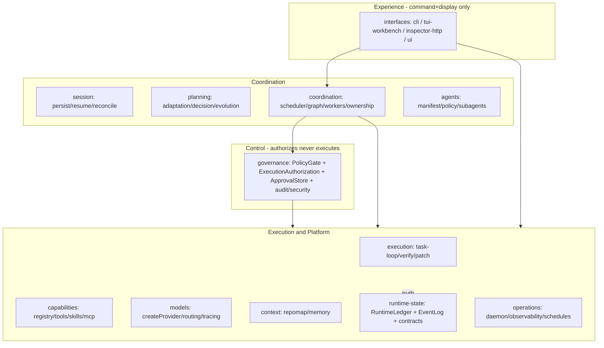

# ALiX — Current Architecture (verified)

> Source-verified @ `3b9337de` (2026-10-14). `src/`: 1435 `.ts` files; `tests/`: 1456 files.
> Claims in `docs/architecture/overview.md` + `AGENTS.md` checked against code + gates.
> Verdict: **12-subsystem claim TRUE physically**; 4-layer DAG documented, **only 3 edges machine-pinned**;
> zero-cycle claim is tooling-gated (`gitnexus check --cycles`), not re-proven here.

## Subsystems (all present)

| Subsystem | Path | Owns |
|---|---|---|
| interfaces | `src/interfaces/{cli,inspector,server,tui,ui}` | CLI+TUI+Inspector HTTP+web UI; command+display only |
| session | `src/session/{index,persist,resume,session-ledger-reconcile}.ts` | lifecycle / persistence / recovery |
| planning | `src/planning/{adaptation,decision,evolution,forecasting,learning,reasoning,reflection,…}` (315 files) | proposals, decisions, adaptation |
| coordination | `src/coordination/{kernel,ownership,sop,workflow}` | graph/planner/scheduler/workers/ownership |
| agents | `src/agents/` (39 files) | builtin names, worker policy, subagent dispatch |
| governance | `src/governance/` (~175 files) | policy/approvals/audit/security — **authorizes, never executes** |
| execution | `src/execution/{executive,patch,recovery,run,verification,verifier}` | task loop, verification, patch |
| capabilities | `src/capabilities/{capability,extensions,integrations,mcp,registry,self-extend,skills,tools}` | tool surface, skills, MCP |
| models | `src/models/{providers,tracing,…}` | adapters, routing, tracing |
| context | `src/context/{baseline,chronicle,repomap,…}` | repomap, context compiler, memory |
| runtime-state | `src/runtime-state/{contracts,events,runtime,storage}` | ledger/events/contracts — **truth** |
| operations | `src/operations/{benchmark,config,daemon,observability,…}` | observability (read-only), daemon, schedules, evals, utils |

Type-only boundaries: `src/runtime-state/contracts/` (`tool-capability-registry`,
`authorized-execution-port`, `approval-decision-port`, `ownership-authority`,
`runtime-event`, `metrics-sink`).

## Diagram (verified implementation)

## Dependency direction

- Enforced (`tests/architecture/layer-boundaries.test.ts:16-34,68-84`): no non-`interfaces`→`interfaces`
  value imports; `runtime-state` ↛ `agents/capabilities/coordination/execution/planning`;
  `models` ↛ `governance` except R5.1 redaction seam
  (`models/providers/provider-contract-validation.ts` → `redactText`). `operations` ungated (cross-cutting).
- Observed: `interfaces/cli|tui|server` → `coordination/kernel` + `runtime-state/runtime` + `governance/*`;
  `coordination/kernel/graph-executor.ts`, `coordination-scheduler.ts` → `ExecutionAuthorization.evaluate()`
  → `PolicyGate` → `ApprovalStore`; `capabilities/tools/executor.ts` → `PolicyGate` first;
  `runtime-state/runtime/*` imported downward, never upward.
- Gates: `r1-boundary-freeze.test.ts` (+`r1-allowlist.json` shrink-only),
  `layer-boundaries.test.ts` (+`layer-allowlist.json` shrink-only),
  `r15-authorization.test.ts`. Scanner covers static+dynamic value imports; type-only exempt.

## Authority ownership (single-owner, verified)

- Policy: `PolicyGate` (`src/governance/policy/policy-gate.ts:169-376`); `RuleEvaluator` first-match-wins;
  `RuntimeGate` adapts graph nodes but routes through `ExecutionAuthorization`.
- Composition: `ExecutionAuthorization.evaluate()`
  (`src/runtime-state/runtime/execution-authorization.ts:32-124`):
  PolicyGate → approval lifecycle → `checkOwnershipGate` → audit/event.
  Used by tools, graph (`evaluateRuntimeGate`), daemon (`daemon-server.ts:480-531`),
  Inspector (`coordination-routes.ts:391-439,605-630`).
- Approvals: `ApprovalStore` (`src/governance/approvals/approval-store.ts`) at
  `.alix/approvals/approvals.json` + ledger authoritative (R2.5 append-is-commit);
  global `~/.alix/approvals` for schedules; CLI unions both.
- Ownership: `OwnershipRegistry` + `isWithinOwnedScope`
  (`src/coordination/ownership/`); liveness `shouldReclaimWorker`; leases only via `releaseWorkerLeases`.
- Completion/scheduling: `createCompletionService`+`deriveRunCompletion`, `createCoordinationScheduler`.
- Tools: `ToolRegistry` + `createToolExecutor` (only importer `tool-executor-factory.ts`).
- Models: `createModelResolver` + `resolveEffectiveModel` (`src/models/providers/`).
- Truth: `getSharedLedger/RuntimeLedger` (`.alix/runtime-ledger.db` SQLite, one-transaction event+version+outbox).
- Containment: `relativeIsOutside` + `WorkspacePathResolver` (lexical+symlink-canonical, sensitive patterns).

## Authorization flow

1. `ToolExecutor` → `PolicyGate.evaluateToolCall` before router; graph nodes
   `CapabilityResolver` → `evaluateRuntimeGate` → same boundary; daemon both branches share one store.
2. Gate order (`policy-gate.ts:182-376`): protected-path deny → deny-command →
   shell-whitelist → evasion regex → config `permissions.tools` × `applySessionMode` →
   owned-path auto-allow/deny (`file.create/delete,patch.apply`) → default → `handleAskDecision`.
3. `handleAskDecision` (`:467-587`): fail-closed except `web.search/web.fetch/task.complete`
   headless-read-allow; bindingKey reuse/consume else create; ask-mode fresh per `requestId`.
4. Continuation resume re-validates durable record (R1.5; `runtime/continuation-store.ts` R2.14).
5. Operator surface CLI-first (`alix approvals {list|pending|show|approve|deny|reconcile}`);
   TUI `approval-resolver.ts`+`approval-manager.ts` (`recordLocally:false`, clear on authoritative projection).
   Sensitive-path denials never escalated.
6. P17 execution plans (`execution-plans.ts`, `execution-approval.ts:54-125`) are separate:
   draft→approved/rejected with operatorId+rationale+approvedActionIds.

## Session / events / observability

- Session R2.18 ledger-authoritative (`src/session/persist.ts:40-109,128-217`): every save appends fact
  FIRST (`session.message_appended` idempotent, `scope/state_saved` latest-wins) via `appendFact`, throws on
  failure; JSONL/JSON is tolerated projection. Loads ledger-first; `resume.ts:308-365` rebuilds
  messages+scope+state+plan. `session-ledger-reconcile.ts` + `alix runtime reconcile-sessions`.
  Non-interactive default; only REPL `/save` passes `interactiveDecisions:true`; `direct` ephemeral.
- EventLog (`src/runtime-state/events/event-log.ts`): per-session `events.jsonl`, single-writer,
  `.lock` (wx, 1s heartbeat, PID liveness, 5s deadline), geometric tail resync.
- Ledger (`.alix/runtime-ledger.db`): one-transaction event+version+outbox; `readEvents` seq order.
- Index/projection read-only: `runtime/runtime-index.ts` (7 backends); CLI `alix runtime {events|timeline}`;
  Inspector `GET /api/runtime/events`, `GET /api/audit`. Scheduler `coordination.tick.completed` gated;
  telemetry → `MetricsSink`, never EventLog.
- Observability (`src/operations/observability/`): closed metric registry + parity with `MinimalMetrics`;
  `alert-engine.ts` (8 HEALTH_RULES); tracing facade (`src/models/tracing/`, Noop+Langfuse/OTel, one span per
  request, redaction-before-truncation, fail-open).

## Models / tools / API / daemon

- Models: single choke `createProvider` (`src/models/providers/registry.ts`)+`withProviderContracts`;
  catalog+specs; `resolveSelectionModelId` (`model-resolver.ts:284-315`); `buildFallbackChain`
  (freeFallback only if primary openrouter + explicit); keys store-only
  (`~/.config/alix/config.json:apiKeys` or `cred://` via credential store; env never consulted).
- Tools: 31 builtins (`src/agents/tool-manifest.ts:2-34`); exact-name resolver; `filterTools` role sets;
  single catalogue `tool-registry.ts`; single seam `createToolExecutor`; `FileToolRouter` + `WorkspacePathResolver`
  on every path; safe-shell grammar (shape only); fetch JSON-LD recovery + SearXNG→Brave fallback.
- Daemon: `DaemonManager` (`src/operations/daemon/daemon-manager.ts:28-159`, `~/.alix/daemon.{pid,json}`,
  socket `~/.alix/alixd.sock`, tasks `~/.alix/daemon-tasks.json` R2.15 ledger-authoritative);
  FIFO one-at-a-time, cooperative cancel, `direct` ephemeral, `run` via `taskRouter`; schedule service 60s tick;
  `ApprovalWatcher` on resolve. CLI `alix daemon {start|stop|status|tasks|cancel}`, `alix submit`.
- Inspector HTTP (`src/interfaces/server/server.ts`): `disabled-loopback-development` only on loopback else
  required auth; Host/origin/proxy-CIDR/rate/connection guards; SSE hubs with `Last-Event-ID` resume;
  GET-only except `POST /api/auth/session|logout`, `POST /api/coordination/run|:runId/cancel`
  (require `coordination:execute`, detached, poll GET, 16KB cap). Close → `cancelAllBackgroundRuns`;
  startup → `resumeInspectorRuns` (reclaim provably-dead owners only).
- TUI/Workbench (`src/interfaces/tui/`, ~60 suites+goldens `tests/tui/workbench/`):
  `snapshot-builder.ts/snapshot.ts` immutable `RuntimeSnapshot` (EventLog→snapshot→views one-way; R4 V1–V10);
  `canvas` default, `opentui` requires TTY. `runTui` (`interfaces/cli/commands/tui.ts:71-90`) no wall-clock deadline.

## Sandbox / auth / identity

- No general agent jail. Three narrow mechanisms: (1) skill `runSandboxed`
  (`src/capabilities/skills/sandbox.ts:142-245`, filtered env+temp cwd, `unshare -Un` best-effort,
  "defense-in-depth, not a jail"); (2) verification `runWithIsolation` opt-in only
  (verify-sandbox/node_modules/.alix/verify/exact root); (3) containment `WorkspacePathResolver`
  (real boundary; every FS operand through resolver).
- Provider keys store-only; workers inherit snapshot over pipe, never argv/env.
- Inspector: token `alix_<id>_<secret>` SHA-256 stored, roles `readonly|operator|admin`+`workspaceIds`
  (`governance/security/inspector/auth-service.ts:28-36,431-568`); sessions in-memory; audit fail-closed
  (0o600, `audit_write_failed` rejects mutation); per-request revalidation.
- Provenance: `AuthorizationEnvelope operator|policy|delegated|system`; `operator` never inferred;
  `agentId` end-to-end (never from `workerId`); outbound redaction strict-`public` (R5.1).
- Gaps for SRAP (see `srap-integration-assessment.md`): **no** WebAuthn/passkeys, device enrollment/revocation,
  mobile/push, cryptographic action binding, replay nonces — only `bindingKey`+`requestFingerprint` dedup,
  `expiresAt` (default 30 min), `decidedBy` free-text, loopback-dev auth bypass.
